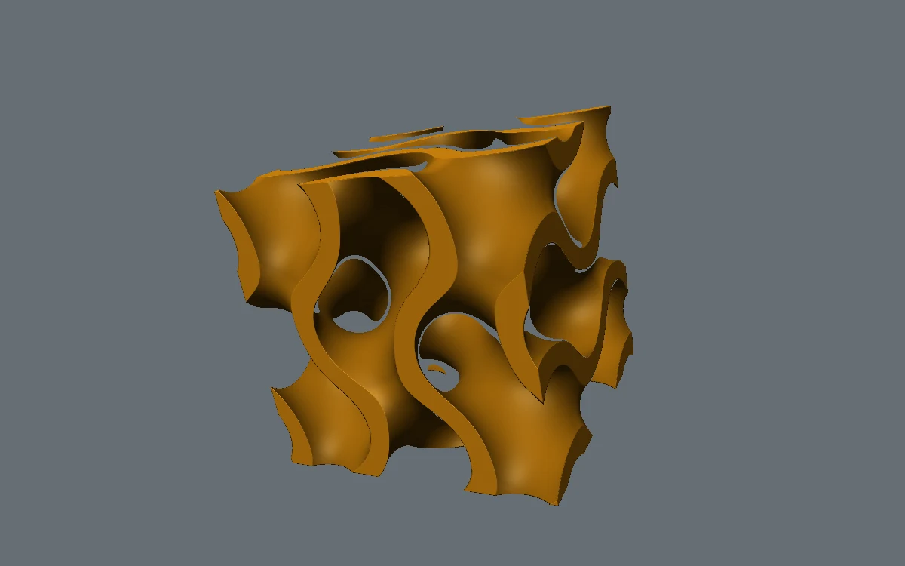

# Gyroid cutaway

> A saffron porous solid turns slowly, revealing continuous internal tunnels.

- **Common name:** Gyroid raymarching shader
- **Category:** WebGL & shaders
- **Live demo:** https://www.subframe.com/motion/gyroid-cutaway
- **Source:** Subframe (original, MIT)
- **Dependencies:** none

## Use case

Material innovation, generative manufacturing, and topology-led brand studies.

## Interaction

Adjust wall thickness

## Look

A softly lit saffron-orange porous cube of curving tunnels, rendered in 3D against a flat mid slate-grey background.

## Motion

The raymarched gyroid cube turns continuously at 0.1 rad/s, roughly one revolution per minute; the wall-thickness slider thickens or opens its tunnels live.

## How to adapt

Shape and lighting live in `FRAGMENT`: `solid` sets spin (`u_time*.10`), gyroid scale (6.4), wall range (`.25+u_control*.35`) and cube size (.69); colour is `vec3(.91,.58,.055)`. Keep the `tick` loop, reduced-motion still and `sg-gyroid-cutaway-fallback`.

## Reduced motion

A representative frame remains still. Live system preference changes immediately stop the loop; the range control continues to update the still image.

## Limitations

Requires WebGL 1. A static CSS fallback appears when unavailable or after context loss. Approximate distance stepping, not an exact signed-distance field; inspect on target GPUs.

## Taxonomy

- **Components:** scene, background
- **Triggers:** ambient, drag
- **Techniques:** shader, 3d, rotate
- **Feel:** technical, calm
- **Contexts:** landing, editorial
- **Tags:** gyroid, implicit surface, raymarching, porous, sculpture, native webgl
- **Also known as:** raymarched 3D shape, rotating lattice cube, porous 3D solid, minimal surface render
- **Surface color:** `#777a80`

## Code

See [`component.tsx`](component.tsx).
