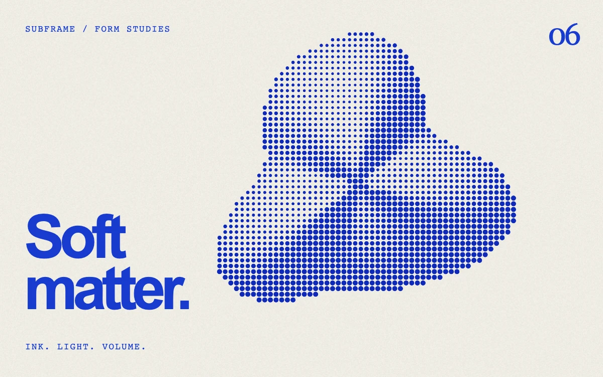

# Halftone sculpture

> A turning organic relief is translated into cobalt ink dots on uncoated paper.

- **Common name:** Halftone dot shader
- **Category:** WebGL & shaders
- **Live demo:** https://www.subframe.com/motion/halftone-sculpture
- **Source:** Subframe (original, MIT)
- **Dependencies:** none

## Use case

Art publications, exhibition identities, editorial portfolios, and print-led motion branding.

## Interaction

Play or pause the material study.

## Look

Warm uncoated off-white paper with a cobalt-blue halftone dot blob, a heavy blue sans headline bottom-left, small spaced monospace labels and a serif numeral.

## Motion

The three-lobed relief slowly rotates (about 84 s per turn) while the light swings side to side every 29 s, so halftone dots continuously grow and shrink with the shading.

## How to adapt

Everything is in `FRAGMENT`: `heightAt` defines the rotating relief (`u_time * .075`), `lamp` the moving light, `spacing` the dot pitch and `inkRadius` the dot size. Swap `paper` and the ink colour, and replace the overlay copy.

## Reduced motion

Displays one stable, representative frame. Responds immediately when the system preference changes.

## Limitations

Requires WebGL 1; a static CSS composition remains visible when WebGL is unavailable or lost. An analytic relief with moving light, not a full 3D mesh. Fine ink dots may alias when the canvas is downscaled.

## Taxonomy

- **Components:** background, scene
- **Triggers:** ambient
- **Techniques:** shader, noise, rotate
- **Feel:** refined, calm
- **Contexts:** editorial, landing
- **Tags:** halftone, sculpture, ink, dots, print, cobalt, relief, editorial, native webgl
- **Also known as:** halftone effect, dot screen shader, print halftone animation, halftone 3D shape
- **Surface color:** `#f0eee5`

## Code

See [`component.tsx`](component.tsx).
