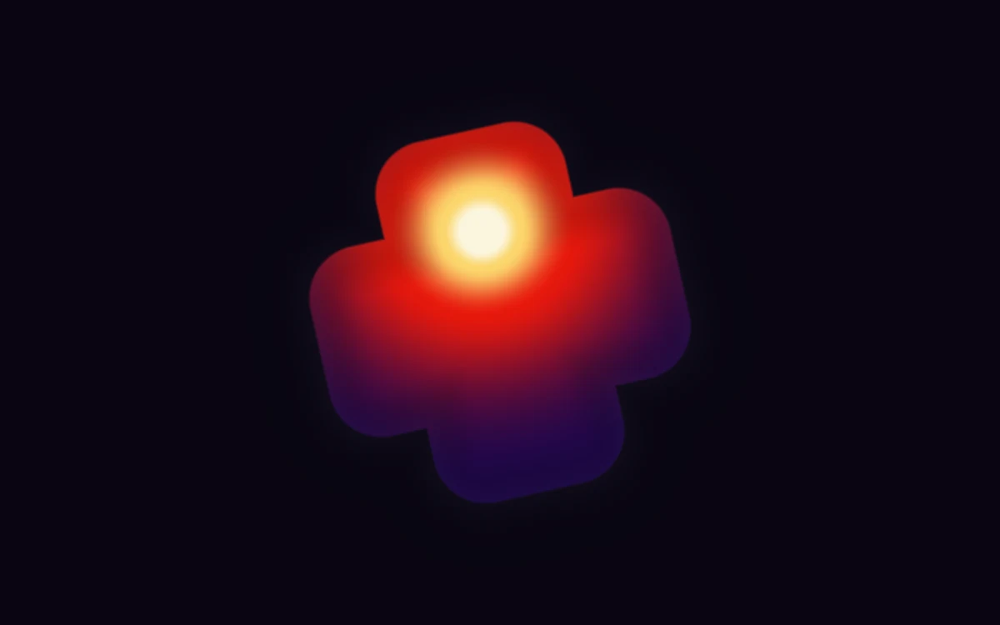

# Heat signature

> Heat moves through a soft-edged cross in violet, vermilion, and hot white.

- **Common name:** Thermal heatmap shader
- **Category:** WebGL & shaders
- **Live demo:** https://www.subframe.com/motion/heat-signature
- **Source:** Subframe (original, MIT)
- **Dependencies:** none

## Use case

A compact thermal identity, focus indicator, or generative art accent.

## Interaction

Adjust hotspot

## Look

Rounded plus-shaped mark tilted on a near-black violet field, glowing from deep violet through vermilion to a white-hot yellow core.

## Motion

A heat hotspot inside the rounded cross drifts up and down on a ~21 s sine while faint bands shift; the range slider moves it sideways.

## How to adapt

The effect is the `FRAGMENT` shader: `shape` is the cross's distance field, `center` the hotspot path, `hot` its falloff and `material` the violet-to-white ramp. Swap `shape` for your mark; keep the WebGL lifecycle and reduced-motion branch.

## Reduced motion

A representative frame remains still. Live system preference changes immediately stop the loop; the range control continues to update the still image.

## Limitations

Requires WebGL 1. A static CSS fallback appears when unavailable or after context loss. Decorative heat map, not a thermal camera or numerical heat-diffusion solver.

## Taxonomy

- **Components:** background
- **Triggers:** ambient, state
- **Techniques:** shader, gradient, glow
- **Feel:** bold, calm
- **Contexts:** landing, editorial
- **Tags:** thermal, heatmap, heat, gradient, silhouette, native webgl
- **Also known as:** thermal camera effect, infrared glow shape, heat map gradient logo, hotspot gradient mark
- **Surface color:** `#120e21`

## Code

See [`component.tsx`](component.tsx).
