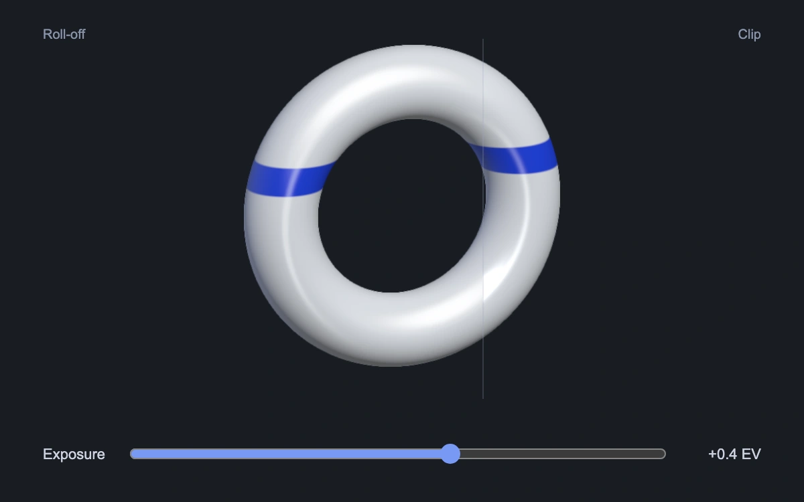

# Highlight headroom

> A blue-striped enamel loop compares controlled highlight compression with hard clipping under the same exposure.

- **Common name:** Interactive highlight roll-off shader
- **Category:** WebGL & shaders
- **Live demo:** https://www.subframe.com/motion/highlight-headroom
- **Source:** Subframe (original, MIT)
- **Dependencies:** none

## Use case

Art-direct bright material reflections while seeing what hard clipping removes.

## Interaction

Drag horizontally or move Exposure from −2 to +2 EV; compare the roll-off region with the clipping sliver.

## Look

White enamel ring with a cobalt stripe on near-black; a narrow right-hand clipping comparison and an exposure slider.

## Motion

Exposure multiplies the same linear radiance on both sides before display encoding. `toneMap` compresses the left side through `shoulder`; the right side clamps channels to display white.

## How to adapt

`DEFAULT_CONFIG` and the `config` prop expose shoulder start, strength, light width and hue preservation. `shoulder` and `toneMap` operate on linear radiance; `u_exposure` is independent EV stage state and `encode` applies display gamma afterward.

## Reduced motion

The scene has no autonomous motion. Exposure changes update immediately through pointer, touch or keyboard input.

## Limitations

An SDR presentation of a procedural linear-radiance signal, not an HDR display test. The tone curve is an authored monotonic shoulder, not a certified reference operator. WebGL 1 with original SVG fallback and context restoration.

## Taxonomy

- **Components:** scene, slider
- **Triggers:** drag, keyboard
- **Techniques:** shader, 3d
- **Feel:** refined, technical
- **Contexts:** landing, editorial
- **Tags:** tone mapping, highlight, exposure, HDR signal, roll-off, clipping, enamel
- **Also known as:** highlight shoulder, tone mapping comparison, exposure compensation, HDR compression
- **Surface color:** `#10151f`

## Code

See [`component.tsx`](component.tsx).
