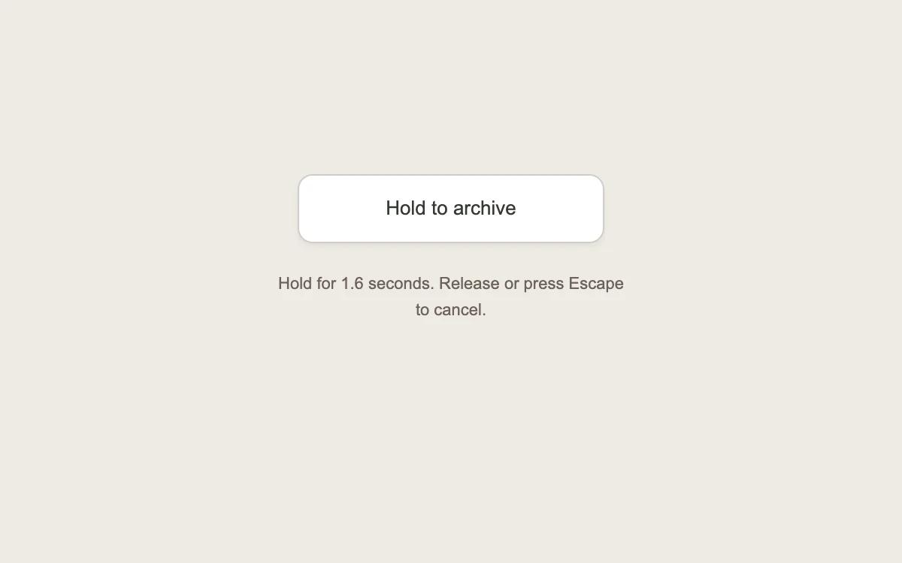

# A deliberate hold

> A progress sweep makes the time needed for an important action visible.

- **Common name:** Hold-to-confirm button
- **Category:** Components & interactions
- **Live demo:** https://www.subframe.com/motion/hold-to-confirm
- **Source:** Interior (adapted, MIT) — https://www.interior.dev/docs/hold-to-confirm · [original code](https://github.com/ddoemonn/interior/blob/314800833bf01e23e6ae74c2a17fbdaac3688c84/components/interior/hold-to-confirm.tsx)
- **Dependencies:** motion@12.0.5

## Use case

Add a deliberate confirmation gesture to an occasional action, with clear cancellation.

## Interaction

Hold the button, or hold Space or Enter

## Look

Warm off-white page with one white rounded button and a grey caption underneath.

## Motion

Holding the button sweeps a dark fill left to right at constant speed for 1.6 s; releasing early drains it back 2.5× faster; completion confirms.

## How to adapt

Hold timing and cancellation live in `useHoldToConfirm` (the example passes `duration: 1600`); the fill is a `clipPath` inset driven by `animate` with linear easing. Replace the archive label and `onConfirm`; keep pointer-cancel and Escape handling.

## Reduced motion

The timer still requires a deliberate hold; text reports progress and the fill changes only at completion.

## Limitations

Demonstrates a local archive state. Pausing cancels any hold and disables confirmation until resumed. Reduced motion preserves the full hold time. Offer another confirmation method if a sustained press is unsuitable for your users.

## Taxonomy

- **Components:** button
- **Triggers:** press
- **Techniques:** mask
- **Feel:** subtle
- **Contexts:** app
- **Tags:** archive, button, press and hold, confirmation, progress, clip-path, pointer, keyboard
- **Also known as:** long press button, press and hold to delete, confirm destructive action
- **Surface color:** `#eeeae5`

## Code

See [`component.tsx`](component.tsx).
