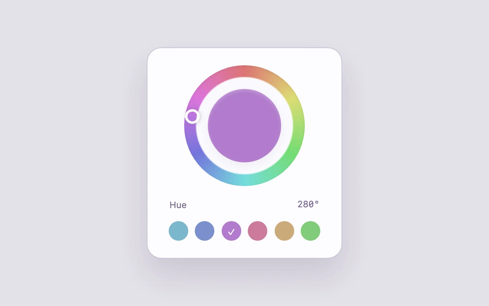

# Hue wheel

> Explore a color continuously with direct manipulation and an exact keyboard value.

- **Common name:** Color wheel picker
- **Category:** Components & interactions
- **Live demo:** https://www.subframe.com/motion/hue-wheel
- **Source:** Subframe (original, MIT)
- **Dependencies:** none

## Use case

Explore a color continuously with direct manipulation and an exact keyboard value.

## Interaction

Choose a hue

## Look

Lavender-grey page with a white rounded card: a pastel rainbow ring around a solid colour disc, a monospace degree readout and six round swatches.

## Motion

Dragging around the ring rotates the white thumb to the pointer's angle and recolours the centre disc instantly; swatches jump the hue, and arrow keys step one degree.

## How to adapt

`update` converts the pointer angle (`Math.atan2`) into `hue`, which rotates `wheel-thumb` and fills `wheel-center` with `color` (fixed 44% saturation, 64% lightness); the ring is a CSS `conic-gradient`. Replace the swatch hues with your palette and add saturation or lightness controls if needed.

## Reduced motion

Live system preference disables decorative motion; all controls remain usable. Keyboard actions settle immediately.

## Limitations

HSL hue control with fixed saturation and lightness; this is not a perceptually uniform or full-gamut color picker.

## Taxonomy

- **Components:** picker, slider
- **Triggers:** drag, press, keyboard
- **Techniques:** rotate, gradient
- **Feel:** subtle
- **Contexts:** app
- **Tags:** color, hue, wheel, picker, direct manipulation
- **Also known as:** circular color picker, hue ring slider, color dial, HSL hue selector, swatch picker
- **Surface color:** `#edf0f3`

## Code

See [`component.tsx`](component.tsx).
