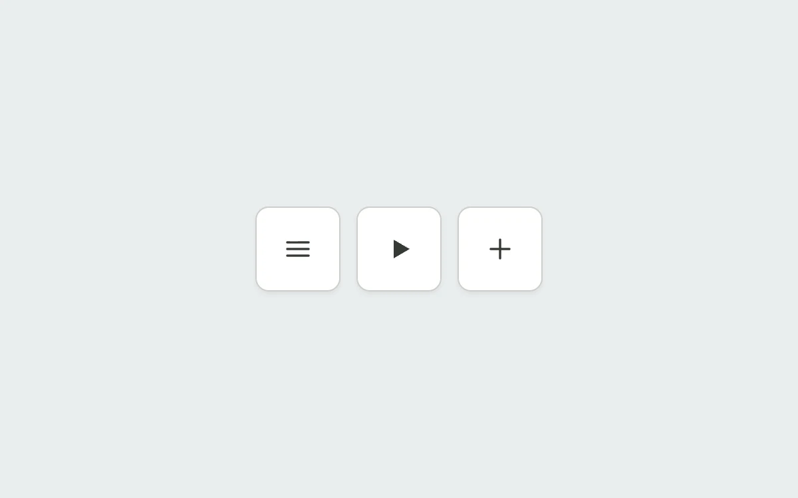

# Icons between states

> A menu, a playback symbol and an add action keep their identity while changing shape.

- **Common name:** Animated icon morph
- **Category:** Components & interactions
- **Live demo:** https://www.subframe.com/motion/icon-morph
- **Source:** Interior (adapted, MIT) — https://www.interior.dev/docs/icon-morph · [original code](https://github.com/ddoemonn/interior/blob/314800833bf01e23e6ae74c2a17fbdaac3688c84/components/interior/icon-morph.tsx)
- **Dependencies:** motion@12.0.5

## Use case

Connect the two states of an occasional icon action with continuous SVG geometry.

## Interaction

Toggle each icon

## Look

Light blue-grey page with three white rounded-square icon buttons in a row showing dark grey menu, play and plus glyphs.

## Motion

Pressing springs each icon's path data to its pair: menu crosses into close while turning 90°, play splits into pause bars, plus flattens to minus with a half turn.

## How to adapt

`useIconMorph` picks shapes from `iconMorphPresets` and `normalize` pads them to equal path counts, collapsing spares to the centre; each `motion.path` animates `d` and the wrapper `rotate` with the `CELL` spring. Add your own `MorphShape` pairs with matching point counts per slot.

## Reduced motion

Paths update immediately and rotation is removed.

## Limitations

These controls demonstrate local states. Connect their state to a real menu, player or item action in your application.

## Taxonomy

- **Components:** button, toggle
- **Triggers:** press, state
- **Techniques:** morph, spring, rotate
- **Feel:** subtle, refined
- **Contexts:** app
- **Tags:** icon, SVG, path morph, click, toggle, menu, play pause, spring
- **Also known as:** hamburger to close animation, play pause toggle, plus to minus icon, SVG path morph, menu icon transition
- **Surface color:** `#e9edef`

## Code

See [`component.tsx`](component.tsx).
