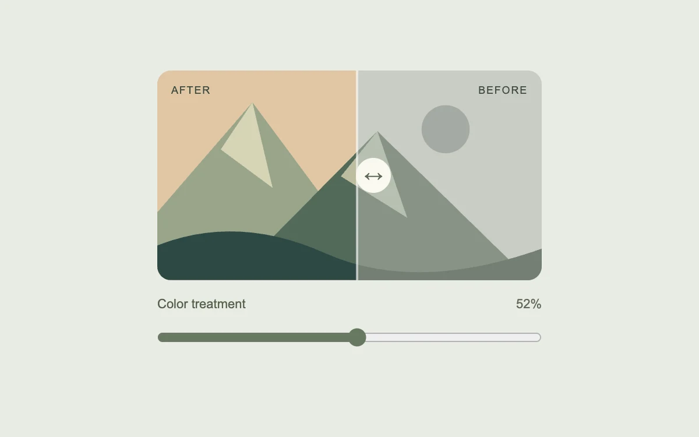

# Before meets after

> A smooth reveal makes two treatments easy to compare in one view.

- **Common name:** Before and after image slider
- **Category:** Components & interactions
- **Live demo:** https://www.subframe.com/motion/image-comparison
- **Source:** Motion Primitives (adapted, MIT) — https://motion-primitives.com/docs/image-comparison · [original code](https://github.com/ibelick/motion-primitives/blob/120f64f6ca60348e251f929e9c81f11ccbe45eda/components/core/image-comparison.tsx)
- **Dependencies:** motion@12.0.5

## Use case

Compare image grading, themes or visual edits without switching back and forth between separate images.

## Interaction

Drag the comparison slider

## Look

Pale sage page with a rounded flat-vector mountain scene, warm colour left and desaturated grey right, divided by a round handle, with a slider below.

## Motion

Dragging across the image or the range slider moves a divider and clip-path reveal on a stiff, well-damped spring; keyboard steps jump straight to the value.

## How to adapt

`position` is a `useSpring` (`stiffness: 380, damping: 36, mass: 0.5`) mapped to `clipPath` as `inset(0 ${100 - current}% 0 0)` and to `x` on a full-width handle-positioning layer. The handle translates without layout; the clip-path reveal remains a separate rendering cost. Replace both `Landscape` layers with equal-sized images and alt text; keep `jump` for keyboard and reduced motion.

## Reduced motion

The reveal follows the slider immediately. Keyboard adjustments also skip the spring.

## Limitations

Uses original inline SVG artwork. Replace both landscape layers with equally sized images and suitable alternative text for real projects.

## Taxonomy

- **Components:** image, slider
- **Triggers:** drag, keyboard
- **Techniques:** mask, spring
- **Feel:** subtle, refined
- **Contexts:** app, landing
- **Tags:** comparison, before and after, image, range, drag, clip-path, spring, reveal
- **Also known as:** image compare slider, split-view reveal, wipe comparison, photo edit comparison
- **Surface color:** `#e9ece4`

## Code

See [`component.tsx`](component.tsx).
