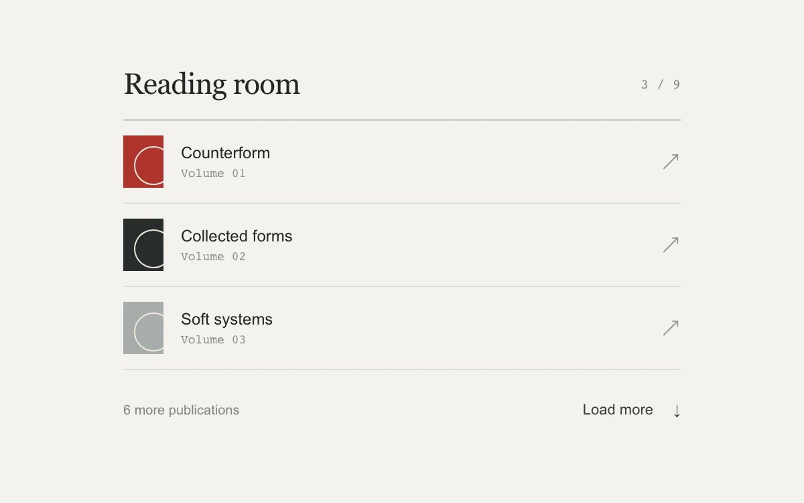

# Incremental list

> An archive loads more records in place, with a recoverable failed batch.

- **Common name:** Load more list with retry
- **Category:** Components & interactions
- **Live demo:** https://www.subframe.com/motion/incremental-list
- **Source:** Subframe (original, MIT)
- **Dependencies:** none

## Use case

Browse a collection without replacing the current page or losing the reading position.

## Interaction

Load the next batch, retry the first failed request, and reach the final record.

## Look

Warm off-white page with a serif heading, a ruled list of publication rows with small red, black and grey geometric covers, and a text button.

## Motion

Pressing load more shows a 600 ms loading status; the first request fails, then retrying appends three rows that fade and rise 4 px over 180 ms.

## How to adapt

`phase` (idle, loading, error) and `count` drive the list, the `setTimeout` effect stands in for a fetch (first call fails via `failed`), and rows enter with `load-w2`. Replace `records` and the timeout with your paginated request.

## Reduced motion

New rows appear without entrance motion; all load and retry states remain visible.

## Limitations

Nine local records with an intentional first-request failure; no network pagination.

## Taxonomy

- **Components:** list, button
- **Triggers:** press, loading, enter
- **Techniques:** fade, slide
- **Feel:** subtle
- **Contexts:** app, editorial
- **Tags:** pagination, append, load-more, retry, error, recovery, scroll, list
- **Also known as:** load more button, paginated list, append results, retry failed request, show more rows
- **Surface color:** `#f3f2ee`

## Code

See [`component.tsx`](component.tsx).
