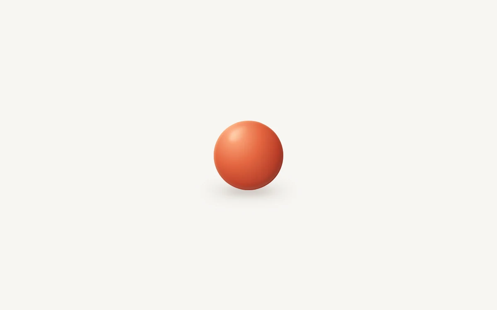

# Pull and release

> A satin sphere and its ground shadow turn a bounded pull into a finite rebound.

- **Common name:** Drag-and-release physics ball
- **Category:** Animation & motion
- **Live demo:** https://www.subframe.com/motion/inertial-launcher
- **Source:** Subframe (original, MIT)
- **Dependencies:** none

## Use case

Playful direct manipulation and a tangible release response.

## Interaction

Pull the ball, then release

## Look

Plain warm off-white canvas with a single satin coral-red sphere, soft specular highlight and a blurred contact shadow beneath.

## Motion

Drag pulls the ball up to 65 px; release flings it opposite the pull through a 1.1 s keyframed hop and smaller rebound with squash-and-stretch, its shadow fading with height.

## How to adapt

The flight is the `frames` array played by `animate` over 1100 ms on both `ball` and `shadow`; tune the `at` offsets, `sx`/`sy` squash, the 1.35 throw multiplier and `height`. The ±65 px pull clamp lives in `onPointerMove`; restyle `.sf-launch-ball`.

## Reduced motion

Releasing returns directly to rest with no flight.

## Limitations

Authored bounded rebound keyframes, not a general physics engine.

## Taxonomy

- **Components:** scene
- **Triggers:** drag, keyboard
- **Techniques:** physics, spring, scale
- **Feel:** playful
- **Contexts:** landing
- **Tags:** inertia, ball, drag, release, rebound, physical, gesture
- **Also known as:** slingshot ball, bouncy ball toy, squash and stretch ball, pull to launch
- **Surface color:** `#f7f6f3`

## Code

See [`component.tsx`](component.tsx).
