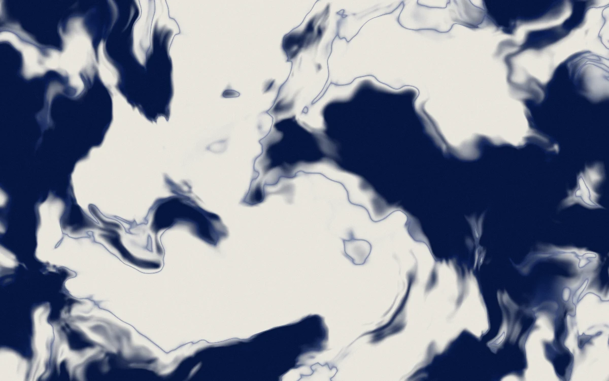

# Ink current

> Indigo ink stretches into fine branching currents on pale paper.

- **Common name:** Ink marbling shader
- **Category:** WebGL & shaders
- **Live demo:** https://www.subframe.com/motion/ink-current
- **Source:** Subframe (original, MIT)
- **Dependencies:** none

## Use case

Art direction for publications, printmaking, and quiet generative backgrounds.

## Interaction

Adjust stir

## Look

Full-bleed pale paper-grey field with large deep indigo ink pools, feathered edges and fine blue contour lines, like marbled paper.

## Motion

Indigo ink drifts very slowly through domain-warped noise while a local swirl twists back and forth on a roughly 48 s sine; the slider moves the swirl centre sideways.

## How to adapt

The marbling is the `FRAGMENT` shader: `layered` is four-octave noise, the `q` warp sets turbulence, `a` the swirl strength and speed (`sin(u_time*.13)`), and `ink` and `edge` the thresholds; recolour the `vec3` values. Keep the WebGL lifecycle and reduced-motion branch.

## Reduced motion

A representative frame remains still. Live system preference changes immediately stop the loop; the range control continues to update the still image.

## Limitations

Requires WebGL 1. A static CSS fallback appears when unavailable or after context loss. Analytic currents rather than a fluid/advection solver; no persistent pointer trail or velocity texture.

## Taxonomy

- **Components:** background
- **Triggers:** ambient, state
- **Techniques:** shader, distortion, noise
- **Feel:** calm, refined
- **Contexts:** editorial, landing
- **Tags:** ink, fluid, marbling, domain warp, paper, native webgl
- **Also known as:** marbled ink background, fluid ink shader, suminagashi effect, domain warp noise, liquid marble texture
- **Surface color:** `#e7e5df`

## Code

See [`component.tsx`](component.tsx).
