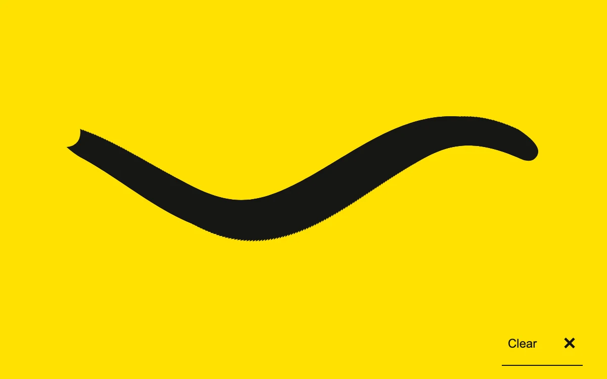

# Ink trail

> A pointer leaves a bold, persistent brush trail across a yellow print surface.

- **Common name:** Cursor brush trail
- **Category:** Animation & motion
- **Live demo:** https://www.subframe.com/motion/ink-trail
- **Source:** Subframe (original, MIT)
- **Dependencies:** none

## Use case

Playful drawing surfaces, creative annotations and expressive identity moments.

## Interaction

Draw with a pointer, touch or arrow keys; clear to begin again

## Look

Flat bright yellow field with one thick black calligraphic brush stroke in a gentle S-curve and an underlined text button in the corner.

## Motion

Moving the mouse, or dragging with touch or pen, stamps direction-rotated brush marks about every 3 px, leaving a persistent stroke; arrow keys extend it stepwise.

## How to adapt

Marks are interpolated in `point` and stored by `add` (capped at 900); `draw` stamps each `Mark` as a quadratic-curve blob, so tune its `size` and the `step` spacing. Replace the initial sine stroke and the yellow `#ffe000` surface.

## Reduced motion

Direct input places persistent marks without ambient motion or animated travel.

## Limitations

Bounded to the latest 900 marks; no pressure-sensitive stylus handling, undo or export.

## Taxonomy

- **Components:** cursor, editor
- **Triggers:** pointer, drag, keyboard
- **Techniques:** canvas
- **Feel:** playful, bold
- **Contexts:** landing, editorial
- **Tags:** cursor, drawing, canvas, ink, trail, brush, gesture
- **Also known as:** mouse paint trail, drawing canvas, marker stroke effect, pointer brush
- **Surface color:** `#ffe000`

## Code

See [`component.tsx`](component.tsx).
