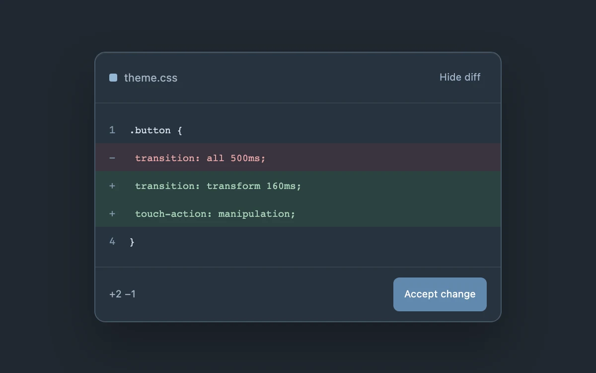

# Inline diff

> Compare a focused code change without leaving its surrounding context.

- **Common name:** Inline code diff
- **Category:** Components & interactions
- **Live demo:** https://www.subframe.com/motion/inline-diff
- **Source:** Subframe (original, MIT)
- **Dependencies:** none

## Use case

Compare a focused code change without leaving its surrounding context.

## Interaction

Review and accept the change

## Look

Dark slate code card with a file header, monospace lines, a muted red removed row and two green added rows, and a steel-blue accept button.

## Motion

Accepting collapses the removed line's height over 200 ms with ease-out while the added rows' green tint fades away; the header toggle collapses only the removed line.

## How to adapt

The collapse is the `old` row's `gridTemplateRows` switching `1fr` to `0fr` under a 200 ms `grid-template-rows` transition; acceptance flips `data-accepted` on `new` rows. Replace the hard-coded `code` lines and wire `setAccepted` to your apply action.

## Reduced motion

Live system preference disables decorative motion; all controls remain usable. Keyboard actions settle immediately.

## Limitations

A focused code-review sample. Acceptance changes local presentation and does not edit files.

## Taxonomy

- **Components:** table, disclosure
- **Triggers:** press, state
- **Techniques:** layout, fade
- **Feel:** subtle, technical
- **Contexts:** app
- **Tags:** diff, review, code, accept, disclosure
- **Also known as:** code review diff, accept change suggestion, AI code suggestion card, collapsible diff lines, unified diff viewer
- **Surface color:** `#edf0f3`

## Code

See [`component.tsx`](component.tsx).
