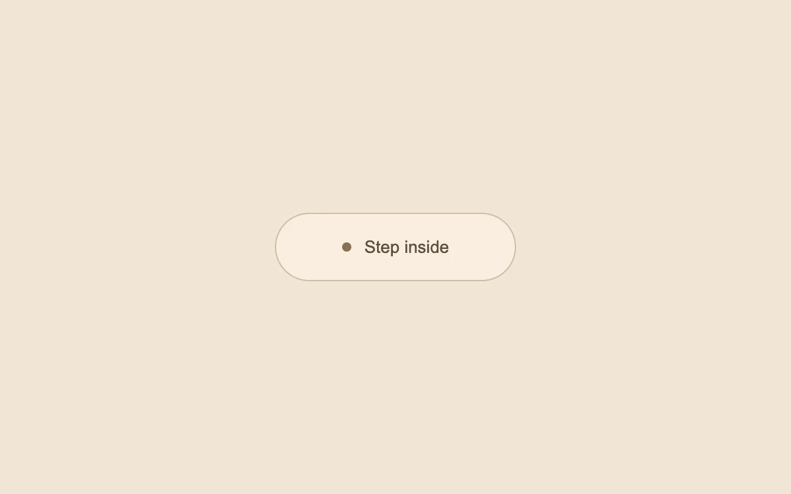

# An invitation on hover

> A tiny dot fills the button as a second label and arrow arrive.

- **Common name:** Fill hover button
- **Category:** Components & interactions
- **Live demo:** https://www.subframe.com/motion/interactive-hover-button
- **Source:** Magic UI (adapted, MIT) — https://magicui.design/docs/components/interactive-hover-button · [original code](https://github.com/magicuidesign/magicui/blob/85f97fd27b053339af74ba9dd4ca428ee25989fb/apps/www/registry/magicui/interactive-hover-button.tsx)
- **Dependencies:** none

## Use case

Give a prominent occasional action an expressive pointer response.

## Interaction

Hover, then click the invitation

## Look

Warm sand-beige page with a single pale cream pill button outlined in tan, with a small brown dot beside a brown sans label.

## Motion

Hovering scales the dot 80× to flood the pill (300 ms expo ease-out); the label slides right and fades while a cream label and arrow arrive from the right.

## How to adapt

All motion is CSS on hover: `.mg-hoverbutton-dot` scales to `scale(80)`, `.mg-hoverbutton-firsttext` translates and fades, `.mg-hoverbutton-second` slides in; tune the `cubic-bezier(.19,1,.22,1)` timings. Replace the label text and colours; keep the reduced-motion and focus-visible fallbacks.

## Reduced motion

The surface changes color immediately; labels do not slide.

## Limitations

Hover enhancement applies only to fine pointers. Keyboard and touch preserve a usable standard button. The action toggles local state.

## Taxonomy

- **Components:** button
- **Triggers:** hover, press
- **Techniques:** scale, slide, fade
- **Feel:** refined, playful
- **Contexts:** landing
- **Tags:** button, hover, fill, expanding dot, arrow, label transition, click
- **Also known as:** CTA hover effect, expanding dot button, arrow reveal button, circle fill hover, get started button hover
- **Surface color:** `#f1e6d6`

## Code

See [`component.tsx`](component.tsx).
