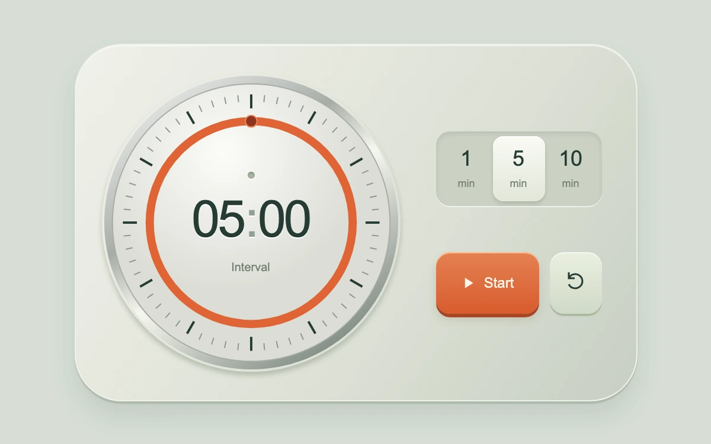

# Interval clock

> A single enamel countdown dial depletes around an inset numeric readout, with tactile interval keys.

- **Common name:** Countdown timer dial
- **Category:** Components & interactions
- **Live demo:** https://www.subframe.com/motion/interval-clock
- **Source:** Subframe (original, MIT)
- **Dependencies:** none

## Use case

Focus periods, rehearsal intervals and deliberate timed activities.

## Interaction

Choose 1, 5 or 10 minutes; start, pause or reset.

## Look

Sage-grey rounded console: a silver-bezel clock face with minute ticks and an orange ring around large numerals, beside segmented presets and an orange start key.

## Motion

Pressing start counts down in whole-second steps: the orange ring and its end dot retreat counter-clockwise to twelve, the digits tick and a lamp lights; the key stays depressed.

## How to adapt

A 100 ms `setInterval` running `tick` updates `remaining`; `progress` sets the `sf-ic-progress` circle's `strokeDasharray` and the dot position, and presets call `reset`. Change the `[1, 5, 10]` presets and hook completion to your own alert.

## Reduced motion

The countdown and ring update in discrete seconds; decorative button transitions are removed.

## Limitations

Local browser timer; no alarm, background notification or persisted session. Host pause freezes elapsed time.

## Taxonomy

- **Components:** number, progress
- **Triggers:** press, state
- **Techniques:** path
- **Feel:** refined, technical
- **Contexts:** app
- **Tags:** clock, timer, countdown, interval, dial, svg, physical-ui
- **Also known as:** pomodoro timer, focus timer, circular countdown, timer progress ring, kitchen timer
- **Surface color:** `#d7ded6`

## Code

See [`component.tsx`](component.tsx).
