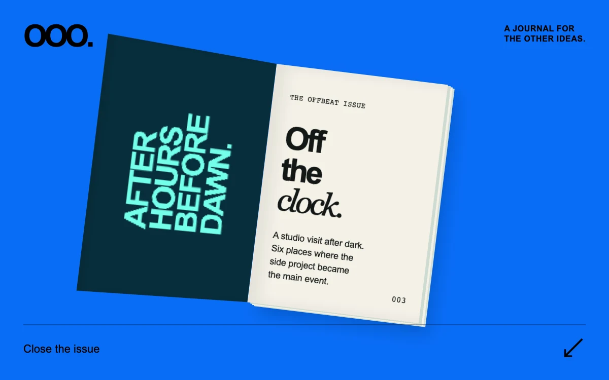

# Odd one out

> A cyan culture journal opens around its spine to reveal the first page.

- **Common name:** Magazine cover page turn
- **Category:** Animation & motion
- **Live demo:** https://www.subframe.com/motion/issue-turn
- **Source:** Subframe (original, MIT)
- **Dependencies:** none

## Use case

Offer a tactile preview of a publication, lookbook or small editorial collection before taking readers into the full content.

## Interaction

Open the issue

## Look

Bright cobalt-blue field with a tilted magazine, shown open: dark teal inside cover of rotated aqua type beside a cream page of heavy black type.

## Motion

Pressing the toggle swings the cover open around its left spine from −12° to −152° over 640 ms with a strong ease-out; closing reverses from its current angle.

## How to adapt

`turn` animates `transform` with `element.animate` from the computed pose to `rotateY(-152deg)` or `rotateY(-12deg)` (640 ms, `cubic-bezier(.22,.8,.2,1)`); `sf-issue-front` and `sf-issue-back` are the backface-hidden faces. Replace the cover and page copy.

## Reduced motion

The cover changes to its open or closed pose immediately. Keyboard activation also skips the turn.

## Limitations

A single rigid cover turn, not a deforming paper simulation or full reader. Native 3D transforms are required for the dimensional presentation.

## Taxonomy

- **Components:** card, disclosure
- **Triggers:** press
- **Techniques:** 3d, rotate
- **Feel:** bold, refined
- **Contexts:** editorial, landing
- **Tags:** book, magazine, editorial, cover, page turn, fold, CSS 3D, WAAPI, preview
- **Also known as:** book cover flip, 3D book opening, page flip animation, magazine preview, lookbook cover reveal
- **Surface color:** `#096df7`

## Code

See [`component.tsx`](component.tsx).
