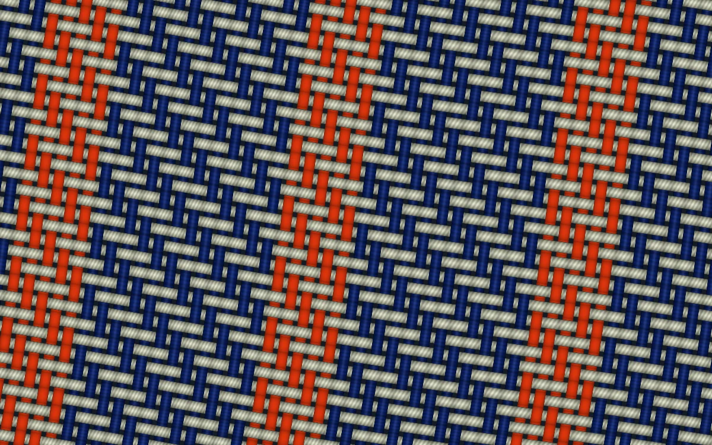

# Jacquard thread

> Cobalt and unbleached threads cross in a visible twill with a burnt-orange stripe.

- **Common name:** Woven textile shader
- **Category:** WebGL & shaders
- **Live demo:** https://www.subframe.com/motion/jacquard-thread
- **Source:** Subframe (original, MIT)
- **Dependencies:** none

## Use case

Control the width and construction of a woven material at thread scale.

## Interaction

Adjust thread width.

## Look

Full-bleed tilted twill weave of cobalt warp and unbleached cream weft threads, with evenly spaced burnt-orange warp stripes and fine fibre ridges.

## Motion

The weave is static apart from a faint sheen on each thread that brightens and dims on a roughly 31-second sine; the thread-width slider thickens or thins threads.

## How to adapt

The weave is all in `main` of `FRAGMENT`: `rot(-.16)` and `29.` set angle and density, `over` sets the twill step, `selvedge` places the orange stripes and `lamp` drives the sheen. `controlRef` feeds `u_control` (thread `width`); recolour `warp`, `weft` and `col`.

## Reduced motion

The elapsed-time clock stops. Parameter controls immediately update the static composition.

## Limitations

Requires WebGL 1; a static CSS swatch appears if unavailable or after context loss. Analytic crossing shadows and thread profiles; no cloth physics or measured fibre-scattering model.

## Taxonomy

- **Components:** background
- **Triggers:** ambient, state
- **Techniques:** shader, glow
- **Feel:** calm, refined
- **Contexts:** landing, editorial
- **Tags:** native webgl, weave, warp, weft, twill, textile, material
- **Also known as:** fabric texture background, twill weave pattern, procedural cloth material, denim weave texture
- **Surface color:** `#e6e8df`

## Code

See [`component.tsx`](component.tsx).
