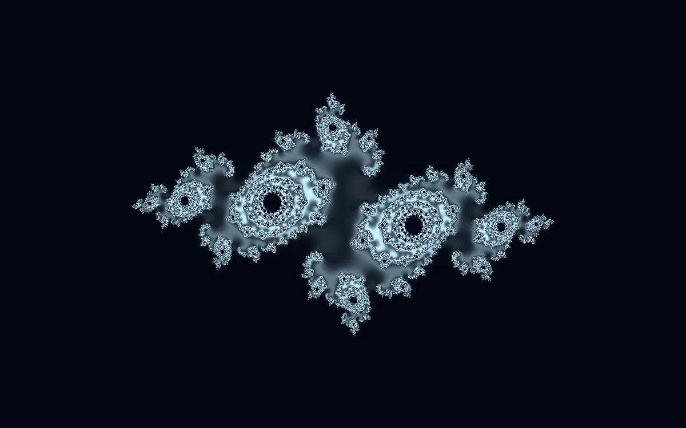

# Julia atlas

> An intricate cyan fractal changes its connected islands as a complex parameter moves.

- **Common name:** Fractal shader
- **Category:** WebGL & shaders
- **Live demo:** https://www.subframe.com/motion/julia-atlas
- **Source:** Subframe (original, MIT)
- **Dependencies:** none

## Use case

Explore topology in a complex-plane image without a 3D engine.

## Interaction

Adjust parameter.

## Look

Pale icy-cyan lace-like fractal of spiral eyes and filigree islands, point-symmetric and centred on a near-black navy field.

## Motion

The Julia set sways slowly, rotating about 3° and drifting its constant on 45–52 s sine cycles; the parameter slider shifts the constant, reshaping and reconnecting its islands.

## How to adapt

In `FRAGMENT`, `c` sets the Julia constant from `u_control` plus a slow `u_time` drift, `rot` adds the sway, and 88 iterations with `smoothCount` and `contours` shade it. Retune the `c` ranges and the cyan `col` mix; keep the fallback.

## Reduced motion

The elapsed-time clock stops. Parameter controls immediately update the static composition.

## Limitations

Requires WebGL 1; a static CSS swatch appears if unavailable or after context loss. 88 escape iterations per pixel; a bounded visual study rather than an arbitrary-precision fractal explorer.

## Taxonomy

- **Components:** background
- **Triggers:** ambient
- **Techniques:** shader, morph
- **Feel:** technical, calm
- **Contexts:** landing, editorial
- **Tags:** native webgl, fractal, julia, complex plane, escape time, generative
- **Also known as:** Julia set shader, animated fractal background, fractal generator, escape-time fractal
- **Surface color:** `#061b29`

## Code

See [`component.tsx`](component.tsx).
