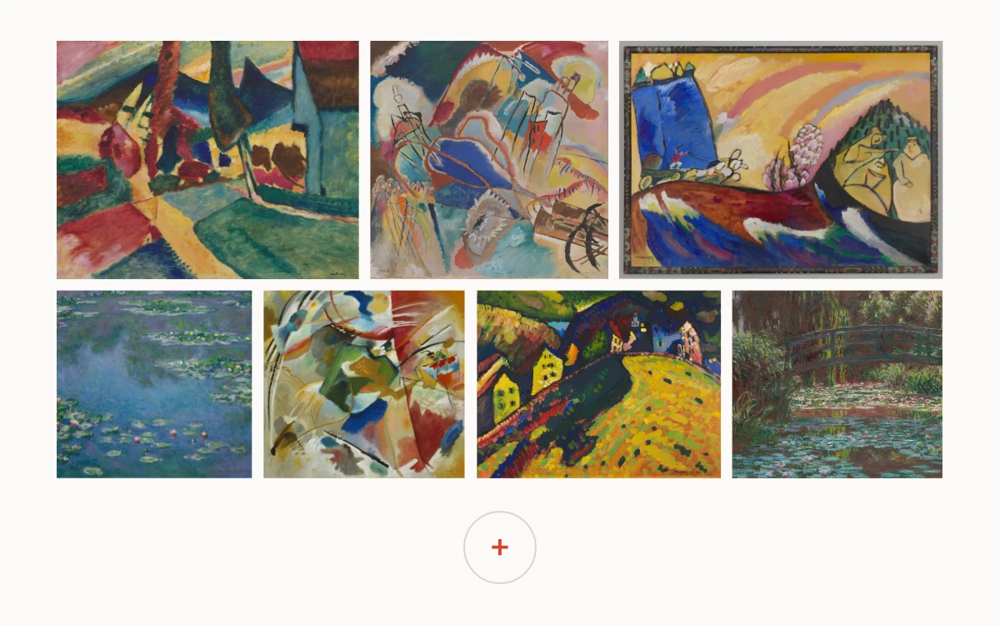

# Into color

> Whole paintings keep their proportions as an expanding collection repacks into aligned rows.

- **Common name:** Justified image gallery reflow
- **Category:** Animation & motion
- **Live demo:** https://www.subframe.com/motion/justified-image-layout
- **Source:** Subframe (original, MIT)
- **Dependencies:** none

## Use case

Build image collections where original aspect ratios and visual continuity matter more than uniform crops.

## Interaction

Add a study, then remove it. Existing artworks change rows while keeping their identities and proportions.

## Look

A warm-white curatorial wall of saturated paintings in two flush rows, with a single round plus control centered beneath the artwork.

## Motion

A bounded row-partition search finds aspect-correct boxes. Existing images animate from their currently rendered transform to the new row, and the added study fades into place. Interrupted reflows retain the current visual pose.

## How to adapt

Replace the image dimensions, titles and IDs in `WORKS`; `pack` scores candidate row partitions against `targetHeight` and a fixed stage bound. `gutter` and `lastRow` change the packing, while `layoutMs` controls the next transform transition.

## Reduced motion

Packing updates immediately. Keyboard actions and host pause finish at the target layout without travel.

## Limitations

Eight local public-domain paintings, bounded exhaustive row partitioning and authored 532 px gallery width inside a responsive 600×375 stage. This is not virtualized for large collections.

## Taxonomy

- **Components:** gallery, image
- **Triggers:** press, keyboard, state
- **Techniques:** layout, scale, fade
- **Feel:** refined
- **Contexts:** editorial, app
- **Tags:** justified gallery, aspect ratio, row packing, image layout, FLIP, WAAPI, collection, reflow
- **Also known as:** uncropped image grid, justified photo gallery, aspect preserving image layout, animated row packing, art gallery reflow
- **Surface color:** `#fbfaf7`

## Assets

- [`color-study-8991.webp`](../../assets/color-study-8991.webp) — Improvisation No. 30 (Cannons) (CC0-1.0)
- [`color-study-8980.webp`](../../assets/color-study-8980.webp) — Landscape with Two Poplars (CC0-1.0)
- [`color-study-8987.webp`](../../assets/color-study-8987.webp) — Painting with Green Center (CC0-1.0)
- [`color-study-8983.webp`](../../assets/color-study-8983.webp) — Painting with Troika (CC0-1.0)
- [`color-study-129849.webp`](../../assets/color-study-129849.webp) — Houses at Murnau (CC0-1.0)
- [`color-study-16568.webp`](../../assets/color-study-16568.webp) — Water Lilies (CC0-1.0)
- [`color-study-87088.webp`](../../assets/color-study-87088.webp) — Water Lily Pond (CC0-1.0)
- [`color-study-64818.webp`](../../assets/color-study-64818.webp) — Stacks of Wheat (End of Summer) (CC0-1.0)

## Code

See [`component.tsx`](component.tsx).
