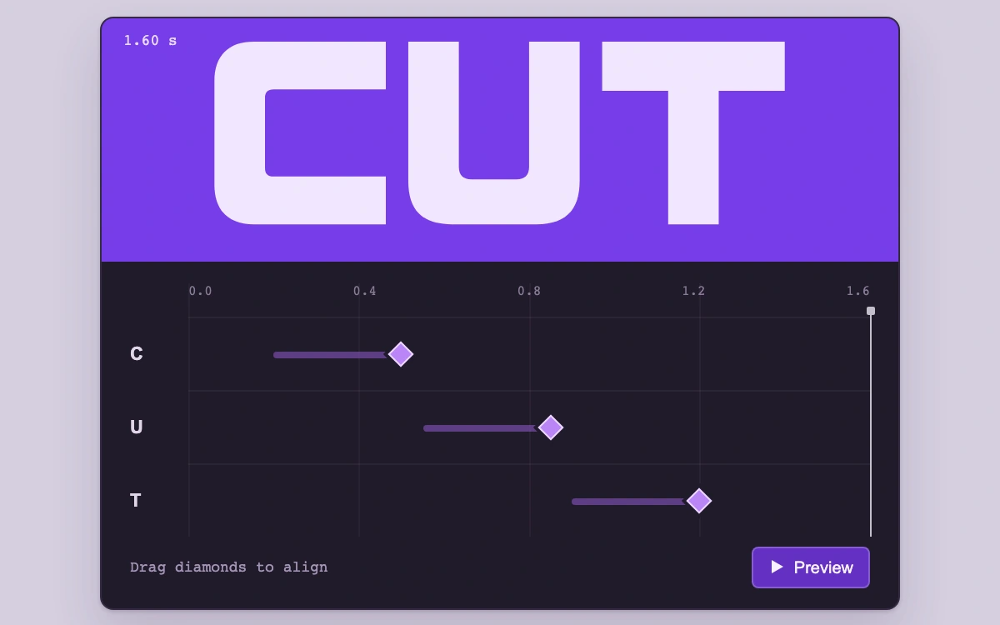

# Letter arrival editor

> Magnetic keyframes set when three original letterforms arrive, with a scrubber and a live preview of the edited timing.

- **Common name:** Keyframe timeline editor
- **Category:** Components & interactions
- **Live demo:** https://www.subframe.com/motion/keyframe-snap
- **Source:** Subframe (original, MIT)
- **Dependencies:** none

## Use case

Synchronizing independent text or graphic entrances with an immediately inspectable animation consequence.

## Interaction

Align the arrival diamonds, scrub the ruler, then preview the animation

## Look

Violet band with large pale block letters above a dark aubergine timeline: three tracks with purple bars, diamond keyframes, a monospace ruler and white playhead.

## Motion

Letters rise into place with cubic ease-out during the 0.3 s before their keyframes; dragged diamonds snap together within 0.045 s; a button plays the 1.6 s timeline.

## How to adapt

Letter motion is computed in render from `time` and `frames` (cubic ease-out over 0.3 s per letter); `update` applies the 0.045 magnetic snap (Alt bypasses) and a `requestAnimationFrame` loop plays to `END`. Replace `outlines` and `letters` with your tracks.

## Reduced motion

Scrubbing shows discrete arrived/not-arrived letter states without translation; Preview becomes an End frame action. A live preference change cancels playback.

## Limitations

Three authored letterform arrivals in a 1.6-second local composition. Each entrance lasts 300 ms and ends at its diamond; no general animation engine or export. Host pause freezes and resumes the current time.

## Taxonomy

- **Components:** editor, text
- **Triggers:** drag, press, keyboard
- **Techniques:** slide, stagger
- **Feel:** technical
- **Contexts:** app
- **Tags:** keyframe, timeline, snap, magnetic, alignment, tracks, editor, typography, kinetic, scrub, sequence
- **Also known as:** animation timeline, snapping keyframes, timeline scrubber, motion sequencer
- **Surface color:** `#d5cfdf`

## Code

See [`component.tsx`](component.tsx).
