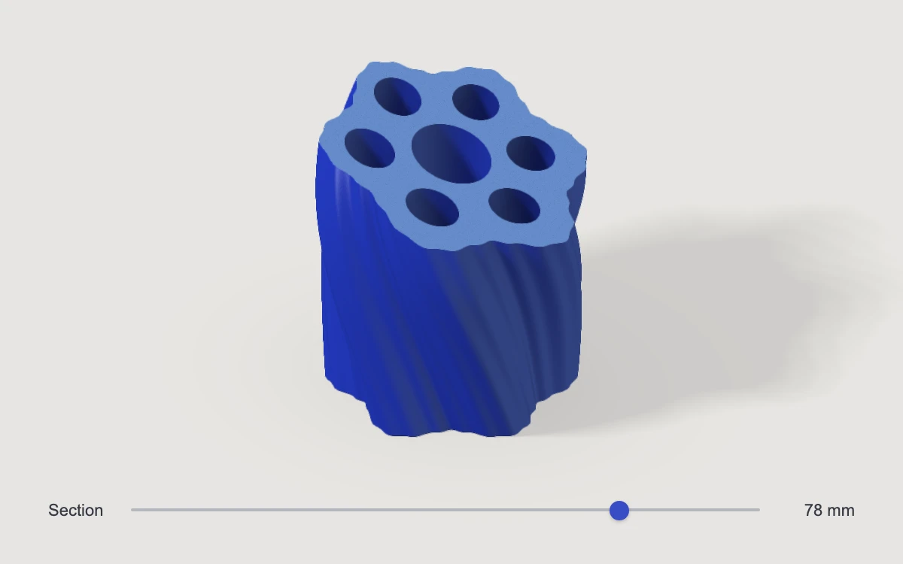

# Through the kiln

> A twisting, fluted cobalt ceramic column opens along a light-blue cut face, revealing seven continuous internal channels.

- **Common name:** Interactive capped cross-section shader
- **Category:** WebGL & shaders
- **Live demo:** https://www.subframe.com/motion/kiln-section
- **Source:** Subframe (original, MIT)
- **Dependencies:** none

## Use case

Explain the wall and cavity construction of an object without separating it into exploded parts.

## Interaction

Drag vertically or move the Section slider to inspect a different cut depth.

## Look

A sculptural cobalt-blue extrusion with twisting flutes, an angled light-blue cut face, seven internal passages and a thin section control on warm stone white.

## Motion

Direct section input moves the clipping plane through the solid; the analytic intersection exposes a separately shaded closed cap and continuous cavities.

## How to adapt

Edit `DEFAULT_CONFIG` or pass `config` for wall thickness, cut angle and cap roughness. `ceramic` defines the bounded solid, `scene` intersects it with `planeNormal`, and `u_depth` is onstage section state.

## Reduced motion

The object remains stationary; direct pointer, touch and keyboard input updates the cut immediately.

## Limitations

A bounded analytic ceramic solid with seven authored channels, not an arbitrary mesh sectioning tool. Requires WebGL 1; a status message appears if unavailable or lost, and the renderer rebuilds on restoration.

## Taxonomy

- **Components:** scene, slider
- **Triggers:** drag, keyboard
- **Techniques:** shader, 3d
- **Feel:** refined, technical
- **Contexts:** landing, editorial
- **Tags:** section, cutaway, ceramic, cap, solid, inspection, native webgl
- **Also known as:** clipping plane, capped cutaway, solid cross section, ceramic construction
- **Surface color:** `#e7e5e0`

## Code

See [`component.tsx`](component.tsx).
