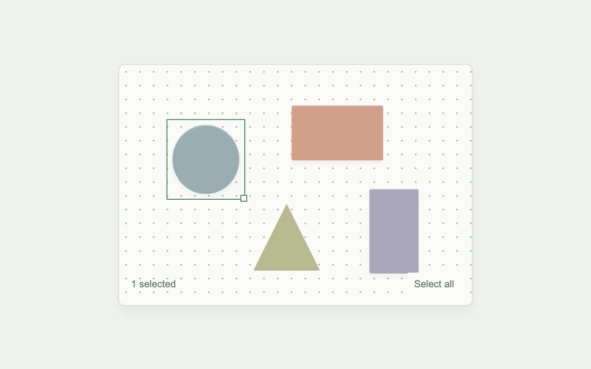

# Marquee selection

> A bounded selection rectangle gathers nearby objects with immediate feedback.

- **Common name:** Drag-to-select rectangle
- **Category:** Components & interactions
- **Live demo:** https://www.subframe.com/motion/lasso-selection
- **Source:** Subframe (original, MIT)
- **Dependencies:** none

## Use case

Selecting groups on a design surface or timeline.

## Interaction

Drag empty space; Shift adds to the selection

## Look

Off-white dotted canvas on a pale sage page with four muted pastel shapes; the selected circle wears a thin green outline and corner handle.

## Motion

Dragging on empty canvas draws a translucent green rectangle from the press point that tracks the pointer, selecting every shape it intersects live; Shift-drag adds to the existing selection.

## How to adapt

Hit-testing lives in the board's `onPointerDown` and `onPointerMove`: percentage coordinates, an axis-aligned overlap test against `objects`, and `onPointerCancel` restoring `previous`. Replace `objects` with your items' bounds and restyle `.sf-lassoselect-marquee`.

## Reduced motion

Selection follows input directly; no decorative travel.

## Limitations

Axis-aligned intersection selection over four fixed shapes, not a freehand polygon lasso or editable canvas.

## Taxonomy

- **Components:** editor
- **Triggers:** drag, press
- **Techniques:** morph
- **Feel:** subtle, technical
- **Contexts:** app
- **Tags:** selection, marquee, lasso, multiselect, canvas, bounds, editor
- **Also known as:** rubber band selection, box select, drag to multi-select, canvas marquee tool, lasso select
- **Surface color:** `#eef0ed`

## Code

See [`component.tsx`](component.tsx).
