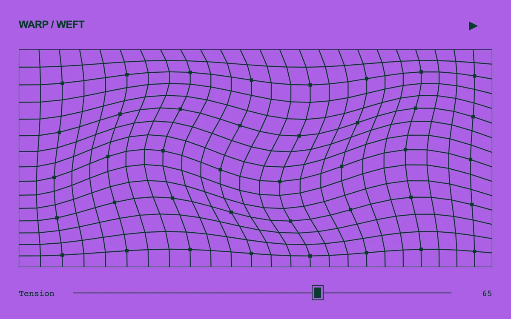

# Lattice wave

> A forest-green line lattice flexes over a violet field as its tension changes.

- **Common name:** Wave grid animation
- **Category:** Animation & motion
- **Live demo:** https://www.subframe.com/motion/lattice-wave
- **Source:** Subframe (original, MIT)
- **Dependencies:** none

## Use case

A controllable woven or technical line texture.

## Interaction

Adjust tension and pause the field.

## Look

Dark green line grid with small square nodes on a vivid violet field, a bold sans label above, a thin slider and monospace readout below.

## Motion

Grid nodes sway continuously in two slow crossing sine waves, damped so the outer frame stays straight; a tension slider scales the amplitude and a button pauses it.

## How to adapt

Everything is drawn in `draw`: `point` displaces each node with sines of `clock`, `amp` scales with `tension`, and `cols`/`rows` set density. Tune the 1700 divisor in `tick` for speed and recolour via `strokeStyle` and the section background.

## Reduced motion

The mesh stays still; tension renders an immediate new static mesh.

## Limitations

Canvas 2D line deformation, not a cloth solver.

## Taxonomy

- **Components:** background
- **Triggers:** ambient
- **Techniques:** canvas, distortion
- **Feel:** technical, calm
- **Contexts:** landing, editorial
- **Tags:** canvas, lattice, grid, wave, sine, tension, geometry
- **Also known as:** warping grid background, animated mesh lines, sine wave grid, distorted grid pattern, flowing wireframe grid
- **Surface color:** `#ad60e5`

## Code

See [`component.tsx`](component.tsx).
