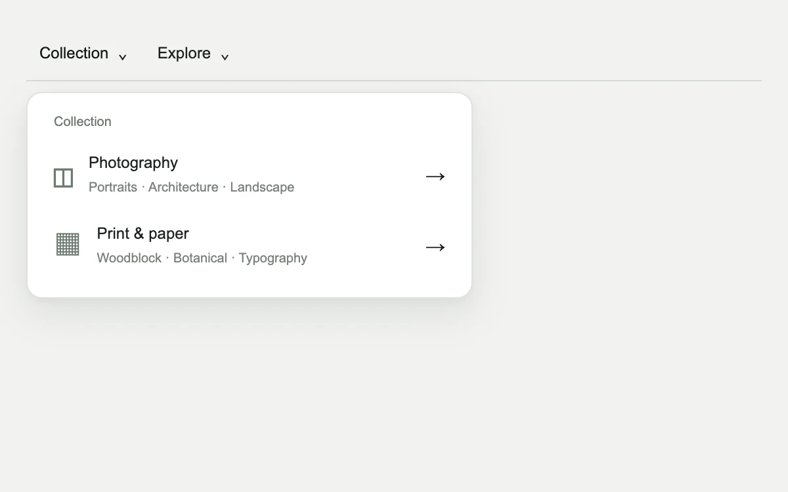

# Layered menu

> A compact archive navigation slides between category and subcategory panels without multiplying popovers.

- **Common name:** Nested drill-down menu
- **Category:** Components & interactions
- **Live demo:** https://www.subframe.com/motion/layered-menu
- **Source:** Subframe (original, MIT)
- **Dependencies:** none

## Use case

Navigate a small hierarchy inside one continuous disclosure surface.

## Interaction

Open a category, drill into a group and choose a collection.

## Look

Pale grey page with a thin top nav of two text dropdowns and a white rounded panel listing categories with grey glyphs, subtitles and arrows.

## Motion

Choosing a category slides a two-page track left in 240 ms with a strong ease-out to show subcategories; the back button reverses it; the panel opens without animation.

## How to adapt

The drill-down is `lm-track` (two `lm-page` panes at 200% width) toggled by `data-deep` with a 240 ms transform transition; `level` picks the subgroup and focus moves in `useLayoutEffect`. Replace `groups` with your hierarchy; keep `inert` on the hidden pane and `data-still`.

## Reduced motion

Hierarchy changes are immediate, preserving the same focus and back actions.

## Limitations

A two-level local collection selector. It uses disclosure buttons rather than application-menu semantics.

## Taxonomy

- **Components:** menu, navigation
- **Triggers:** press
- **Techniques:** slide
- **Feel:** subtle
- **Contexts:** app, editorial
- **Tags:** navigation, hierarchy, nested disclosure, panel transition
- **Also known as:** multi-level dropdown, sliding submenu, nested navigation panel, hierarchical dropdown
- **Surface color:** `#edece6`

## Code

See [`component.tsx`](component.tsx).
