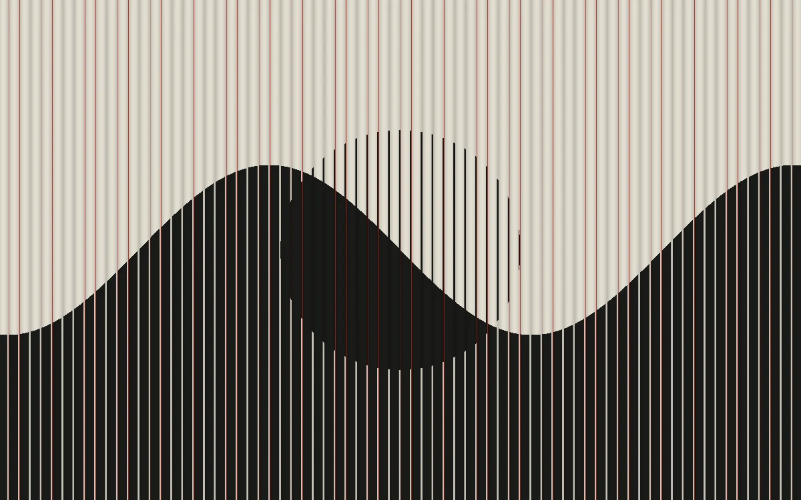

# Lenticular grid

> Black-and-white interlaced artwork flips through narrow red-edged ribs.

- **Common name:** Lenticular flip shader
- **Category:** WebGL & shaders
- **Live demo:** https://www.subframe.com/motion/lenticular-grid
- **Source:** Subframe (original, MIT)
- **Dependencies:** none

## Use case

A tactile switching texture for print-led identities and collectible digital editions.

## Interaction

Adjust view

## Look

Full-bleed cream and near-black graphic of a sine wave and circle, sliced into narrow vertical ribs with thin red edges and cylindrical shading.

## Motion

Each rib's soft threshold between a wave image and a circle image sweeps on an ~18 s sine, flipping the picture back and forth; the slider offsets the view.

## How to adapt

The effect is the `FRAGMENT` shader: `p.x*46.0` sets rib density, `view` the sweep speed and slider range, `ridge` the red edge, and `a` and `b` are the two images to replace. Keep the WebGL lifecycle and reduced-motion branch.

## Reduced motion

A representative frame remains still. Live system preference changes immediately stop the loop; the range control continues to update the still image.

## Limitations

Requires WebGL 1. A static CSS fallback appears when unavailable or after context loss. A screen-space print illusion, not a physical lenticular display. Fine ribs may alias at small scales.

## Taxonomy

- **Components:** background
- **Triggers:** ambient, state
- **Techniques:** shader, mask
- **Feel:** bold, calm
- **Contexts:** landing, editorial
- **Tags:** lenticular, interlaced, optical, view switch, stripes, native webgl
- **Also known as:** lenticular print effect, interlaced image flip, ribbed stripe transition, two-image view switch
- **Surface color:** `#e4e0d9`

## Code

See [`component.tsx`](component.tsx).
