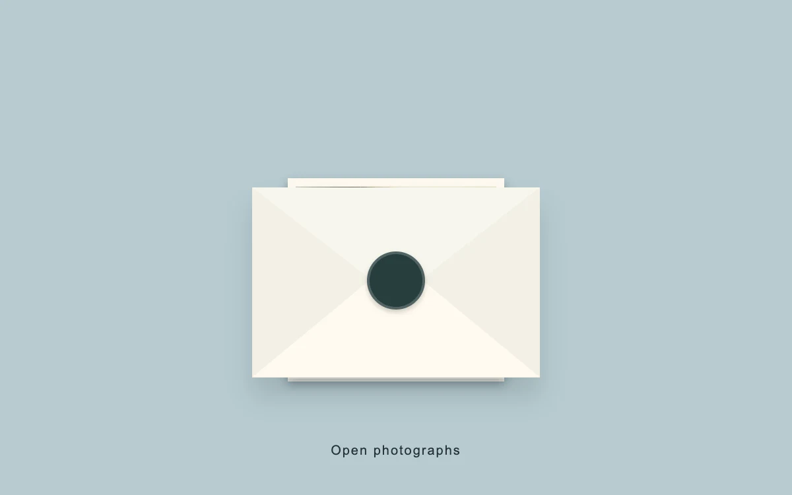

# Letter collection

> A sealed coastal envelope opens into a spread of photographs.

- **Common name:** Envelope open reveal
- **Category:** Components & interactions
- **Live demo:** https://www.subframe.com/motion/letter-collection
- **Source:** Subframe (original, MIT)
- **Dependencies:** none

## Use case

Turn opening a small curated collection into a deliberate reveal.

## Interaction

Open the envelope and browse the photographs.

## Look

Flat cream paper envelope with a round dark green seal and soft shadow, centred on a dusty blue-grey field above a small letterspaced caption.

## Motion

Opening flips the flap back in 3D, shrinks the envelope and fans three tilted photographs up and out over 420 ms ease-out; selecting a photo opens it full-frame.

## How to adapt

Poses are CSS: `.lc-flap` turns to `rotateX(180deg)` under `perspective:800px`, `.lc-envelope` scales to `.55`, and each `.lc-photo` gets an inline fan `transform` (`[-9, 3, 10]` degrees), eased by `420ms cubic-bezier(.22,1,.36,1)`. Replace `views` with your images.

## Reduced motion

The flap and photographs change pose immediately.

## Limitations

Three sample photographs; the envelope and spread are authored transforms rather than paper collision simulation.

## Taxonomy

- **Components:** gallery, dialog
- **Triggers:** press
- **Techniques:** 3d, rotate, slide, scale
- **Feel:** refined, playful
- **Contexts:** editorial, landing
- **Tags:** envelope, fold, collection, reveal, CSS 3D
- **Also known as:** envelope animation, open letter reveal, photo fan out, invitation reveal, photo stack spread
- **Surface color:** `#b8cbd0`

## Assets

- [`blue-tide.webp`](../../assets/blue-tide.webp) — Aerial view photography of ocean (Unsplash)
- [`coastal-break.webp`](../../assets/coastal-break.webp) — Aerial photography of ocean (Unsplash)
- [`mediterranean-clouds.webp`](../../assets/mediterranean-clouds.webp) — Cloudy Sky, Mediterranean Sea (CC0-1.0)

## Code

See [`component.tsx`](component.tsx).
