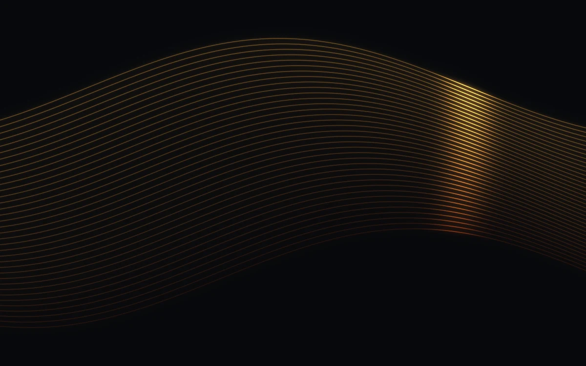

# Light fibre

> Fine amber fibres bend around one moving pulse of light.

- **Common name:** Fiber optic light shader
- **Category:** WebGL & shaders
- **Live demo:** https://www.subframe.com/motion/light-fibre
- **Source:** Subframe (original, MIT)
- **Dependencies:** none

## Use case

Network, sound, or optical technology identities that need a precise luminous texture.

## Interaction

Adjust bend

## Look

Near-black field with a band of thirty-six fine amber-to-rust lines undulating across it, brightened by one soft golden highlight.

## Motion

Thirty-six sine-curved fibres undulate slowly while a Gaussian light pulse sweeps back and forth along them, brightening the strands it crosses; the bend slider scales wave amplitude.

## How to adapt

Everything is in `FRAGMENT`: 36 fibres in the loop, wave speed `u_time*.12`, pulse sweep `.48*sin(u_time*.24+f*.5)` and colour `mix(vec3(.30,.11,.025),vec3(1,.68,.25),f)`; `u_control` (the bend range) scales amplitude. Keep the canvas lifecycle, pause button and fallback.

## Reduced motion

A representative frame remains still. Live system preference changes immediately stop the loop; the range control continues to update the still image.

## Limitations

Requires WebGL 1. A static CSS fallback appears when unavailable or after context loss. Luminous curve rendering without blur post-processing; not a physical fibre-optics simulation.

## Taxonomy

- **Components:** background
- **Triggers:** ambient
- **Techniques:** shader, glow
- **Feel:** calm, refined
- **Contexts:** landing
- **Tags:** fibre, optical, light, strands, signal, native webgl
- **Also known as:** glowing wave lines, flowing lines background, luminous strands hero, light pulse along lines
- **Surface color:** `#13161c`

## Code

See [`component.tsx`](component.tsx).
