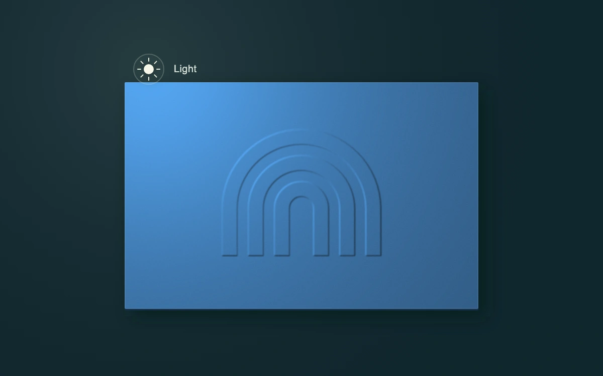

# Embossed paper proof

> A movable studio light reveals the shallow relief of a blind-embossed mark on blue paper.

- **Common name:** Embossed paper lighting
- **Category:** Components & interactions
- **Live demo:** https://www.subframe.com/motion/light-position
- **Source:** Subframe (original, MIT)
- **Dependencies:** none

## Use case

Interactive material proofs, print finishing previews, and direct two-dimensional light controls.

## Interaction

Drag the light or move it with arrow keys

## Look

Matte mid-blue paper card with a blind-embossed nested-arch mark and fine grain, floating on a dark teal-black ground beside a small sun handle.

## Motion

Dragging the sun handle or pressing arrow keys moves an SVG point light; the embossed arches re-shade, a light pool follows and the card's blurred shadow shifts opposite, without easing.

## How to adapt

Lighting is the `relief` filter: `feDiffuseLighting` with an `fePointLight` at `light.x`/`light.y`, while `shadow` offsets the cast shadow by `0.047` per unit. Tune `surfaceScale`, `diffuseConstant` and `lightingColor`; replace the three arch `path` shapes and `#275381` paper with your mark.

## Reduced motion

Light, relief shading, and cast shadow follow input immediately; no idle animation or transition.

## Limitations

SVG point-light diffuse shading over an authored height mask with an approximate projected card shadow. No arbitrary 3D scene, uploaded material, or physically based renderer.

## Taxonomy

- **Components:** card, slider
- **Triggers:** drag, keyboard
- **Techniques:** glow
- **Feel:** refined, technical
- **Contexts:** app, landing
- **Tags:** light, shadow, material, position, 2d, vector, paper, emboss, relief, print, lighting
- **Also known as:** draggable light source, emboss effect, relief lighting demo, print finish preview, XY light control
- **Surface color:** `#10272e`

## Code

See [`component.tsx`](component.tsx).
