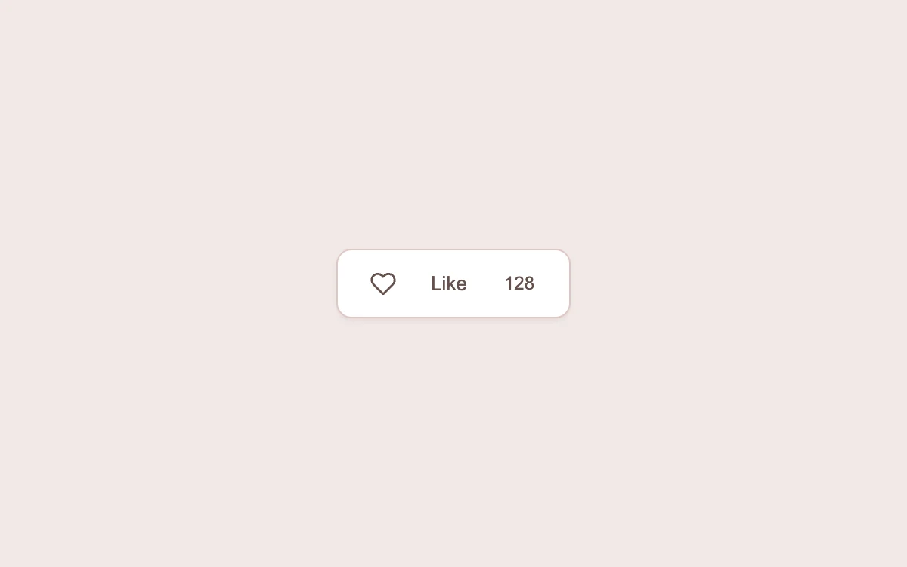

# A little appreciation

> A filled heart, a small burst and a rolling count make a reaction feel responsive.

- **Common name:** Like button heart burst
- **Category:** Components & interactions
- **Live demo:** https://www.subframe.com/motion/like-burst
- **Source:** Interior (adapted, MIT) — https://www.interior.dev/docs/like-burst · [original code](https://github.com/ddoemonn/interior/blob/314800833bf01e23e6ae74c2a17fbdaac3688c84/components/interior/like-burst.tsx)
- **Dependencies:** motion@12.0.5

## Use case

Provide immediate feedback for a low-stakes like, favorite or appreciation action.

## Interaction

Like and unlike the example

## Look

Pale blush page with a single white rounded button holding an outline heart icon, a sans-serif label and a small count.

## Motion

Liking springs a filled heart up from 55% scale over the crossfading outline, fires eight sparks radially for 440 ms, and rolls the count vertically; unliking reverses without sparks.

## How to adapt

State and debounced commit live in `useOptimisticLike` (`settle = 400`, optional `onCommit` with rollback); springs are `CELL` and `CROSSFADE`, sparks come from `SPARKS` with `EASE` over `0.44` s. Pass your `onCommit` and `initialCount`; replace the label.

## Reduced motion

The heart and count update directly; particles, scaling and rolling digits are removed.

## Limitations

The local demo does not save reactions to a server. The retained hook supports asynchronous commit and rollback.

## Taxonomy

- **Components:** button, number
- **Triggers:** press
- **Techniques:** particles, spring, roll, scale
- **Feel:** playful, subtle
- **Contexts:** app
- **Tags:** like, favorite, heart, click, particles, burst, counter, optimistic state
- **Also known as:** favorite button animation, heart reaction, animated like counter, optimistic like toggle
- **Surface color:** `#f2e9e7`

## Code

See [`component.tsx`](component.tsx).
