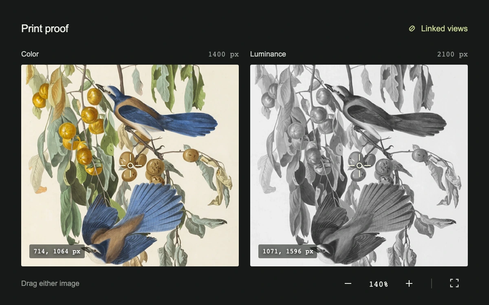

# Print proof

> Inspect a hand-colored bird engraving and its luminance proof through one calibrated camera, even when the images have different raster dimensions.

- **Common name:** Synchronized image pan and zoom
- **Category:** Animation & motion
- **Live demo:** https://www.subframe.com/motion/linked-image-inspection
- **Source:** Subframe (original, MIT)
- **Dependencies:** none

## Use case

Compare print proofs, retouches or imaging channels at matching world coordinates rather than unrelated image-pixel offsets.

## Interaction

Drag either image to move both views. Zoom with the buttons, double-click a view, or use arrow keys, plus, minus and Home. Escape cancels an active drag.

## Look

A precise charcoal proofing surface with blue-and-ochre bird engraving detail beside its monochrome companion, paired white reticles, source-pixel coordinates and quiet zoom controls.

## Motion

Both image transforms derive from the same normalized world center and scale. Drag release coasts by a bounded amount; changing pane preserves the same camera. Different raster sizes produce different pixel readouts for the same physical feature.

## How to adapt

Replace the color and proof assets with calibrated images of the same extent. `RATIO` describes that extent; `bounded` clamps the shared `Camera` to the visible image area. `maxZoom`, `companionRatio`, `panSettleMs` and `showCorrespondence` expose the supported controls.

## Reduced motion

Pan follows direct input; release inertia is disabled. Keyboard and zoom controls update immediately. Host pause cancels release motion and disables input. Cancelling a drag or deactivating the host restores its starting camera.

## Limitations

The two images are known aligned derivatives of one public-domain engraving. No automatic image registration, pinch-to-zoom or color-managed printer simulation is provided.

## Taxonomy

- **Components:** image, editor
- **Triggers:** drag, press, keyboard, pointer
- **Techniques:** slide, scale
- **Feel:** refined, technical
- **Contexts:** app
- **Tags:** synchronized zoom, linked pan, image inspection, proofing, calibration, world coordinates, print proof, comparison
- **Also known as:** linked image viewer, paired image zoom, synchronized image comparison, calibrated image inspection, proof comparison pan
- **Surface color:** `#171918`

## Assets

- [`print-proof-color.webp`](../../assets/print-proof-color.webp) — Florida Jay, public-domain hand-colored engraving (CC0-1.0)
- [`print-proof-1400.webp`](../../assets/print-proof-1400.webp) — Luminance conversion of the same engraving at 1400 px width (CC0-1.0)
- [`print-proof-2100.webp`](../../assets/print-proof-2100.webp) — Luminance conversion of the same engraving at 2100 px width (CC0-1.0)
- [`print-proof-2800.webp`](../../assets/print-proof-2800.webp) — Luminance conversion of the same engraving at 2800 px width (CC0-1.0)

## Code

See [`component.tsx`](component.tsx).
