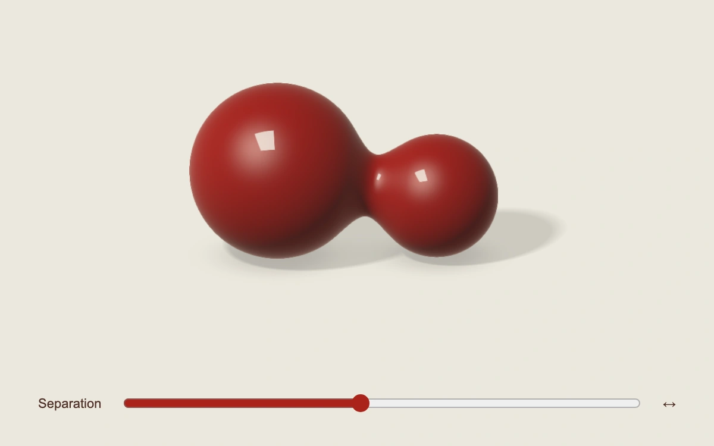

# Liquid bridge

> Two unequal ink-red lacquer drops form and release a smooth neck as their separation changes.

- **Common name:** Interactive liquid coalescence shader
- **Category:** WebGL & shaders
- **Live demo:** https://www.subframe.com/motion/liquid-bridge
- **Source:** Subframe (original, MIT)
- **Dependencies:** none

## Use case

Show a fluid merge or split with a visible moment of attachment and reversible control.

## Interaction

Drag horizontally or adjust Separation to join and part the drops.

## Look

Two unequal dark-red glossy drops on a warm bone field, a crisp rectangular reflection and soft contact shadows.

## Motion

Separation shifts two field centers; `merge` produces the neck. A finite exponential follow catches up to direct input and stops, freezing when inactive or hidden.

## How to adapt

Edit `DEFAULT_CONFIG` or pass `config` for field blend, follow lag and radius ratio. `drops` defines the analytic volumes, `merge` forms their neck, and `u_separation` is independent onstage state.

## Reduced motion

Following is removed and each direct separation change renders immediately. The drops never move autonomously.

## Limitations

A smooth analytic field between two authored volumes, not fluid dynamics or conserved-volume simulation. Follow lag describes interpolation, not viscosity. WebGL 1 with original SVG fallback and context restoration.

## Taxonomy

- **Components:** scene, slider
- **Triggers:** drag, keyboard
- **Techniques:** shader, 3d, morph
- **Feel:** refined, technical
- **Contexts:** landing, editorial
- **Tags:** liquid, coalescence, neck, metaball, merge, lacquer, native webgl
- **Also known as:** metaball merge, liquid neck formation, fluid union, drop separation
- **Surface color:** `#eae6d7`

## Code

See [`component.tsx`](component.tsx).
