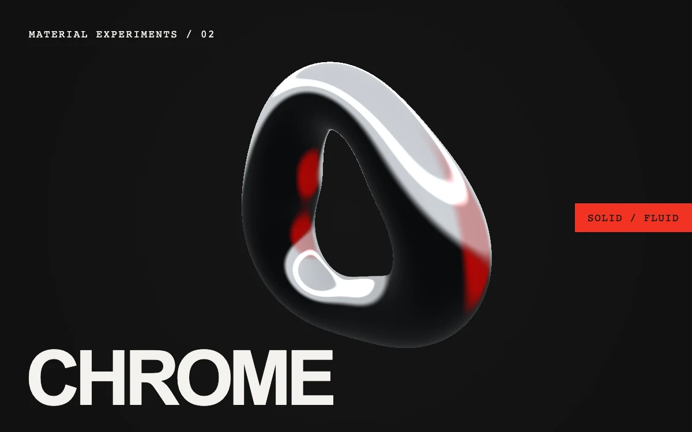

# Liquid chrome

> A sculpted metal loop turns through hard studio highlights and one red reflection.

- **Common name:** Liquid metal chrome shader
- **Category:** WebGL & shaders
- **Live demo:** https://www.subframe.com/motion/liquid-chrome
- **Source:** Subframe (original, MIT)
- **Dependencies:** none

## Use case

Experimental product launches, digital fashion, music identities, or a material-led hero that feels physical.

## Interaction

Play or pause the material study.

## Look

Near-black poster with a glossy chrome ring of black and silver bands with red reflections, heavy cream sans-serif title, monospace caption and red side label.

## Motion

A raymarched chrome torus slowly spins and tumbles while its rim and tube thickness undulate, so studio light bands and a red reflection slide across it; a button pauses it.

## How to adapt

The sculpture is the `object` distance function in `FRAGMENT` (spin `.12 * u_time`, `rim` and `tube` wobble); shading uses `studio`, `strip` and `red`, and the 68-step march sets GPU cost. Replace the title and labels; keep `sg-liquid-chrome-fallback`, context-loss and reduced-motion handling.

## Reduced motion

Displays one stable, representative frame. Responds immediately when the system preference changes.

## Limitations

Requires WebGL 1; a static CSS composition remains visible when WebGL is unavailable or lost. Raymarching is more GPU-intensive than the other textures. The reflections are authored light bands, not a physical environment map.

## Taxonomy

- **Components:** scene, background
- **Triggers:** ambient
- **Techniques:** shader, 3d, morph
- **Feel:** bold, refined
- **Contexts:** landing, editorial
- **Tags:** chrome, liquid metal, raymarching, sculpture, reflective, monochrome, industrial, native webgl
- **Also known as:** chrome torus, raymarched metal ring, reflective 3D sculpture, metallic blob hero
- **Surface color:** `#141414`

## Code

See [`component.tsx`](component.tsx).
