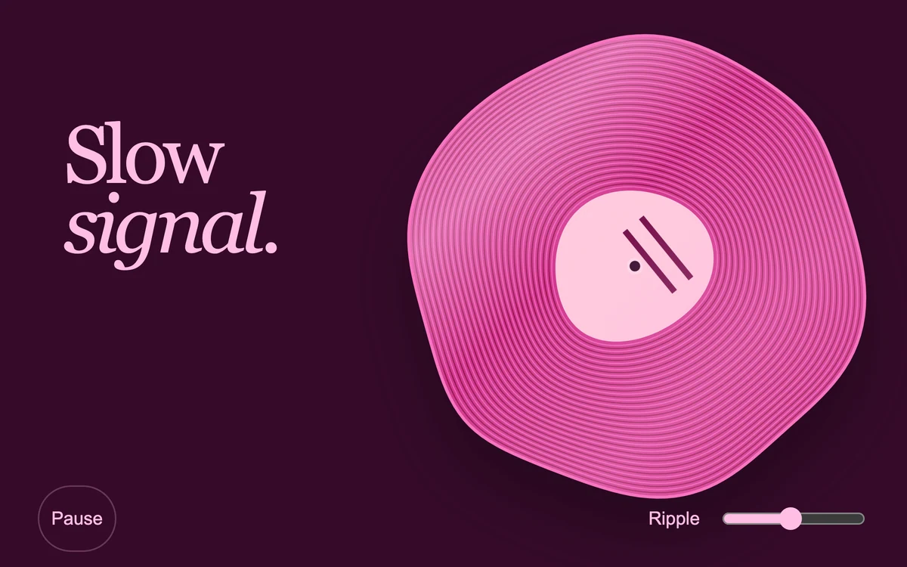

# Liquid record

> Pink lacquer grooves turn and ripple around a small record label.

- **Common name:** Liquid vinyl record
- **Category:** Animation & motion
- **Live demo:** https://www.subframe.com/motion/liquid-record
- **Source:** Subframe (original, MIT)
- **Dependencies:** none

## Use case

Music artwork, material experiments, and motion states for a media interface.

## Interaction

Change ripple intensity or pause the record motion

## Look

Deep plum field with a large wobbly pink vinyl record, fine magenta grooves and pale label, beside a two-line pink serif headline.

## Motion

Each frame the disc's paths are re-plotted with drifting sine displacement so 48 grooves wobble like liquid; the label marks spin every 14 s and a slider sets ripple strength.

## How to adapt

Deformation is `ripplePoint` (sine-cosine offsets scaled by `amount`), applied by `groovePath` to every `data-radius` path in a `requestAnimationFrame` loop; the label spin is `sf-liquid-spin` (14 s linear). Tune `ripple` (0–38) and the frequencies; replace the headline and palette.

## Reduced motion

Both rotation and vector ripple updates stop. Ripple intensity remains adjustable.

## Limitations

Visual record motion only; no audio, track playback or audio-reactive analysis.

## Taxonomy

- **Components:** scene, media
- **Triggers:** ambient
- **Techniques:** distortion, morph, rotate
- **Feel:** calm, playful
- **Contexts:** landing, editorial
- **Tags:** svg, vector deformation, vinyl, record, liquid, material
- **Also known as:** spinning vinyl animation, wobbly record, melting vinyl, warping record illustration, music artwork animation
- **Surface color:** `#350a29`

## Code

See [`component.tsx`](component.tsx).
