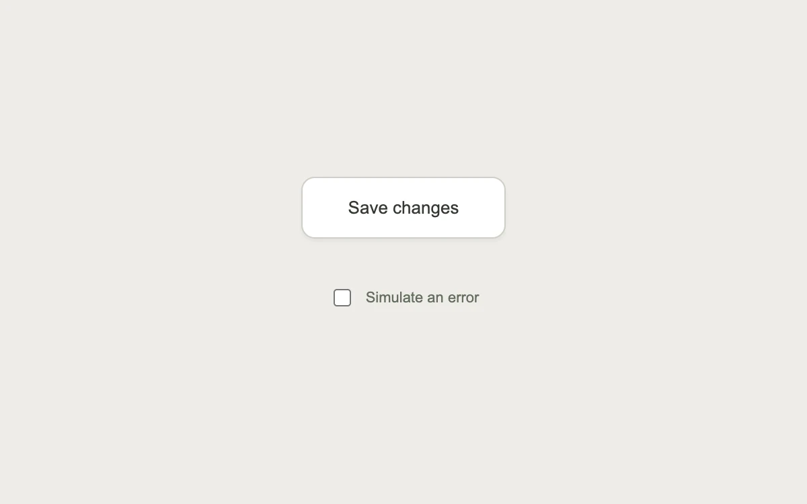

# An action in progress

> A stable button moves through saving, success and error without changing its footprint.

- **Common name:** Async loading button
- **Category:** Components & interactions
- **Live demo:** https://www.subframe.com/motion/loading-button
- **Source:** Interior (adapted, MIT) — https://www.interior.dev/docs/loading-button · [original code](https://github.com/ddoemonn/interior/blob/314800833bf01e23e6ae74c2a17fbdaac3688c84/components/interior/loading-button.tsx)
- **Dependencies:** motion@12.0.5

## Use case

Keep an asynchronous action understandable from the first click through its outcome.

## Interaction

Save changes, then try the error state

## Look

Warm light-grey page with one white rounded bordered button with a soft shadow, and a small checkbox caption below.

## Motion

Clicking spring-crossfades overlapping faces (opacity, 3 px rise, blur) from label to spinner to a green check or red alert at a fixed width, resetting after 1.4 s.

## How to adapt

`useAsyncAction` owns the run-id state machine (`resetAfter` defaults to 1400); each face in `faces` overlaps in one grid cell and animates `opacity`, `y` and `filter` with the `CROSSFADE` spring. Pass your real save to `action` and relabel `faces`.

## Reduced motion

Status labels crossfade without traveling or blurring, and the spinner remains still.

## Limitations

The demo uses a 1.2-second simulated save; connect useAsyncAction to your real action.

## Taxonomy

- **Components:** button, progress
- **Triggers:** press, loading, state
- **Techniques:** fade, blur, spring
- **Feel:** subtle
- **Contexts:** app
- **Tags:** button, click, async, loading, spinner, success, error, crossfade, spring
- **Also known as:** submit button loading state, save button spinner, button success state, stateful button, async action feedback
- **Surface color:** `#eeede8`

## Code

See [`component.tsx`](component.tsx).
