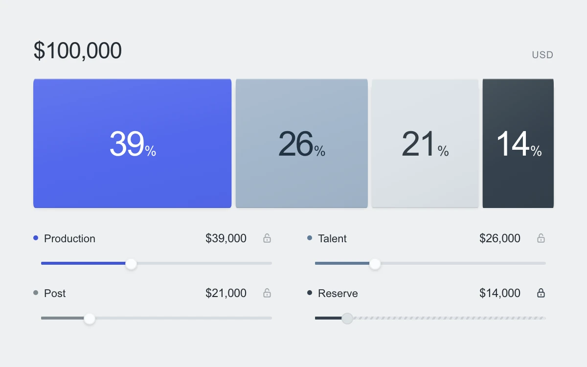

# A budget that stays balanced

> Changing one allocation redistributes the remaining budget across unlocked lines while the total stays exact.

- **Common name:** Locked budget allocation
- **Category:** Components & interactions
- **Live demo:** https://www.subframe.com/motion/locked-budget-balance
- **Source:** Subframe (original, MIT)
- **Dependencies:** none

## Use case

Edit production budgets, capacity or category weights with a fixed total and protected allocations.

## Interaction

Drag an allocation or use its arrow keys. Lock a line to preserve it while other amounts redistribute; Escape cancels the whole drag.

## Look

A dominant cobalt, silver and graphite allocation ribbon with large percentages, a quiet monetary total and a compact two-column set of fine sliders and lock icons.

## Motion

Dragging a handle transfers money between the unlocked lines while the total and protected values stay fixed. Large unscaled percentage labels follow the changing segment centers; neighboring rails and the allocation ribbon settle with transforms. Every slider keeps the same scale when locks change.

## How to adapt

`distribute` preserves the integer total using weighted largest-remainder allocation; `before` anchors each pointer transaction so reversing restores the original proportions. `seed` creates the fixture. Change `LINES` and `COLORS` for another domain. Keep the common slider scale, feasible bounds, Escape rollback and protected values. `DEFAULT_CONFIG` and the `config` prop configure bounds and settling.

## Reduced motion

Pointer edits track directly; keyboard, reduced-motion and inactive-host changes have no settle transition. Pausing cancels a pending transaction and disables controls.

## Limitations

Local integer budget fixture in thousands of dollars. Changing line count, total or minimum resets allocations; an infeasible minimum is capped at floor(total / count). No persistence or financial service integration.

## Taxonomy

- **Components:** slider, toggle, chart, number
- **Triggers:** drag, keyboard, press, state
- **Techniques:** slide, scale
- **Feel:** refined, technical
- **Contexts:** app, dashboard
- **Tags:** budget, allocation, fixed total, locked, redistribution, constraints, integer, slider
- **Also known as:** fixed-sum sliders, constrained allocation, budget redistribution, lock budget line, percentage balance
- **Surface color:** `#eff0f1`

## Code

See [`component.tsx`](component.tsx).
