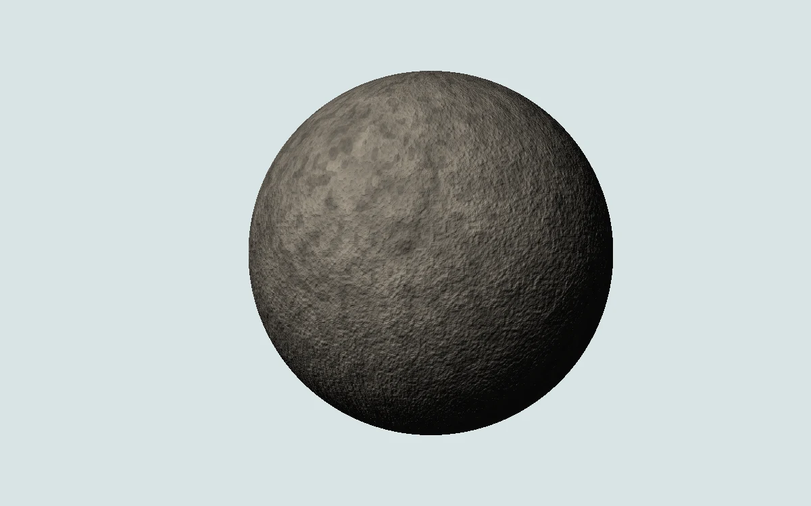

# Lunar regolith

> Raking light reveals a rough mineral moon against an icy white field.

- **Common name:** Moon surface shader
- **Category:** WebGL & shaders
- **Live demo:** https://www.subframe.com/motion/lunar-regolith
- **Source:** Subframe (original, MIT)
- **Dependencies:** none

## Use case

Space, materials science, and quiet editorial illustrations.

## Interaction

Adjust sun angle

## Look

A rough grey-brown pitted sphere with bump-shaded mineral texture, lit from the upper left and fading to black, centred on a pale icy blue-grey field.

## Motion

The sphere's procedural rock surface slowly rotates in longitude while raking light shades its bumps; a sun-angle slider swings the light horizontally across it.

## How to adapt

Terrain is `rock` (layered `grain` noise) in the `FRAGMENT` shader; `u_time*.025` sets spin speed, `radius` the size, and `light` maps `u_control` to the sun direction. Recolour the `vec3(.54,.51,.46)` rock tint and background `c`; keep the WebGL lifecycle.

## Reduced motion

A representative frame remains still. Live system preference changes immediately stop the loop; the range control continues to update the still image.

## Limitations

Requires WebGL 1. A static CSS fallback appears when unavailable or after context loss. Invented terrain and crater-like detail, not geographic or lunar scan data.

## Taxonomy

- **Components:** scene, background
- **Triggers:** ambient
- **Techniques:** shader, noise, 3d, rotate
- **Feel:** calm, refined
- **Contexts:** editorial, landing
- **Tags:** moon, regolith, craters, planet, lighting, native webgl
- **Also known as:** rotating planet shader, procedural moon, 3D planet texture, spinning asteroid, planet hero
- **Surface color:** `#dce6e8`

## Code

See [`component.tsx`](component.tsx).
