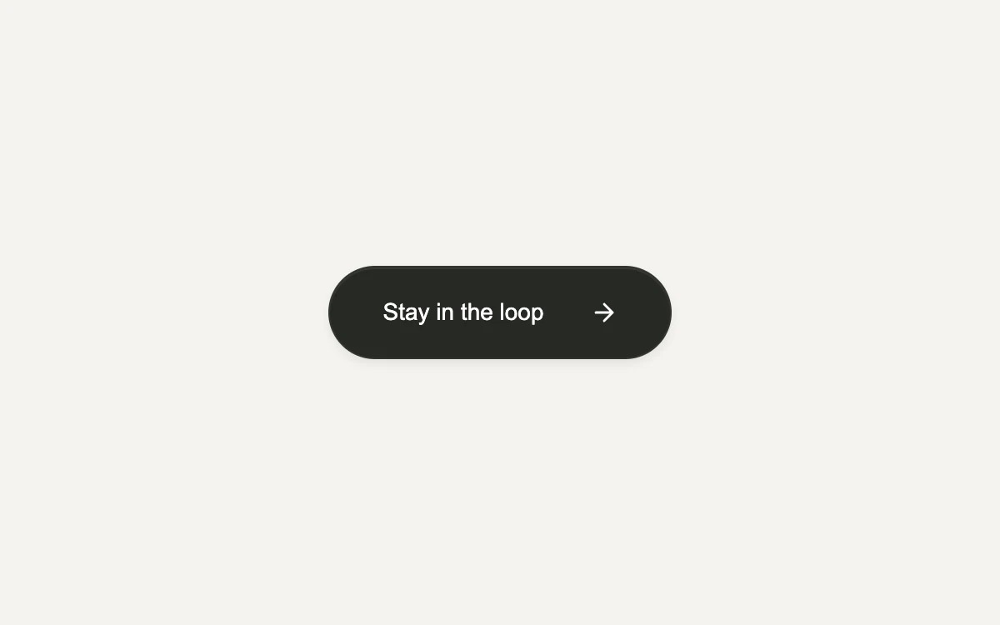

# Magnetic button

> A gentle pull toward the pointer, followed by a spring back to rest.

- **Common name:** Magnetic hover button
- **Category:** Components & interactions
- **Live demo:** https://www.subframe.com/motion/magnetic-button
- **Source:** Motion Primitives (adapted, MIT) — https://motion-primitives.com/docs/magnetic · [original code](https://github.com/ibelick/motion-primitives/blob/120f64f6ca60348e251f929e9c81f11ccbe45eda/components/core/magnetic.tsx)
- **Dependencies:** motion@12.0.5

## Use case

Add a tactile response to an occasional, prominent action. Keep everyday navigation stationary.

## Interaction

Move your pointer over the button

## Look

Warm off-white page with a single dark charcoal pill button holding white sans-serif text and a thin arrow icon.

## Motion

A mouse near the button pulls it toward the pointer (up to 28% of offset, zero beyond 160 px) on a spring; leaving springs it back; pressing scales to 0.97.

## How to adapt

Pull is computed in `move`: `strength` falls off over `160` px with a `0.28` cap, feeding `x` and `y`; `useSpring` (`stiffness: 180, damping: 18, mass: 0.3`) smooths it and `whileTap` scales to `0.97`. Replace the label, icon and `joined` toggle.

## Reduced motion

The button remains stationary; its ordinary interaction still works.

## Limitations

Pointer attraction is an enhancement for a mouse or trackpad. Touch and keyboard use the standard button.

## Taxonomy

- **Components:** button
- **Triggers:** pointer, hover, press
- **Techniques:** spring, scale
- **Feel:** refined, playful
- **Contexts:** landing, app
- **Tags:** button, hover, spring, pointer, gesture
- **Also known as:** magnetic CTA, cursor-attract button, sticky cursor hover, button follows cursor
- **Surface color:** `#eeeae4`

## Code

See [`component.tsx`](component.tsx).
