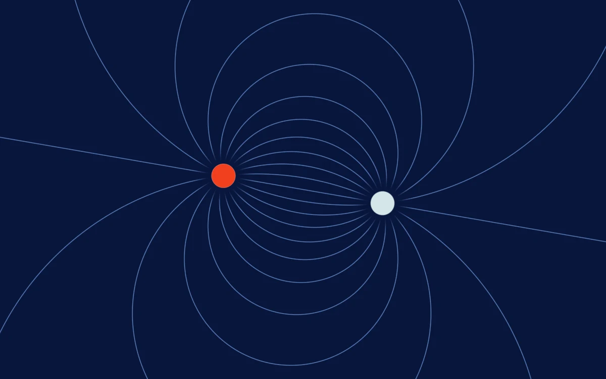

# Magnetic field

> Fine white field lines bend between a pair of quiet cobalt poles.

- **Common name:** Magnetic field lines shader
- **Category:** WebGL & shaders
- **Live demo:** https://www.subframe.com/motion/magnetic-field
- **Source:** Subframe (original, MIT)
- **Dependencies:** none

## Use case

Science, research, or a precise generative identity built from directional flow.

## Interaction

Adjust separation

## Look

Deep navy field with fine pale-blue curved field lines looping between a bright red-orange dot and a pale grey-white dot, flat and diagrammatic.

## Motion

The two poles bob vertically in opposition on a slow 33-second sine, so the field lines continuously bend between them; the separation slider moves the poles apart or together.

## How to adapt

Pole positions `a` and `b` (spaced by `sep`, bobbing with `u_time*.19`) and line density `11.0` live in `main` of `FRAGMENT`; the base colour is `c` and `red` marks one pole. `controlRef` feeds `u_control`; keep the context-loss fallback.

## Reduced motion

A representative frame remains still. Live system preference changes immediately stop the loop; the range control continues to update the still image.

## Limitations

Requires WebGL 1. A static CSS fallback appears when unavailable or after context loss. Qualitative two-pole illustration, not a calibrated electromagnetic field solver.

## Taxonomy

- **Components:** background
- **Triggers:** ambient, state
- **Techniques:** shader
- **Feel:** technical, calm
- **Contexts:** landing, editorial
- **Tags:** magnetic, vector field, field lines, physics, technical, native webgl
- **Also known as:** dipole field lines, physics field background, vector field lines, science hero background
- **Surface color:** `#152b69`

## Code

See [`component.tsx`](component.tsx).
