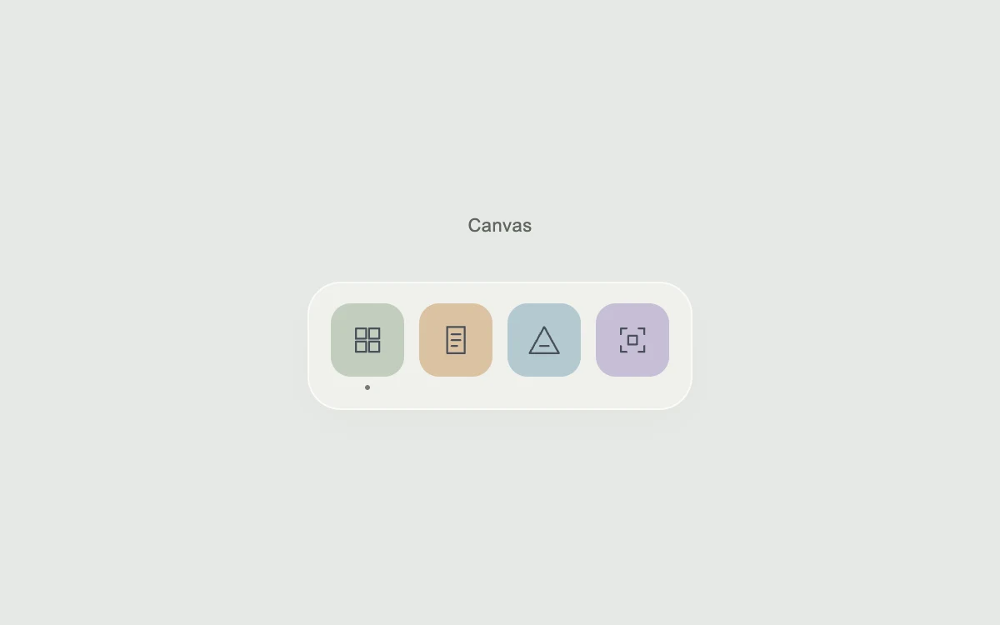

# A dock with a little gravity

> Nearby tools grow gently as the pointer passes across a compact dock.

- **Common name:** Dock magnification effect
- **Category:** Components & interactions
- **Live demo:** https://www.subframe.com/motion/magnifying-dock
- **Source:** Motion Primitives (adapted, MIT) — https://motion-primitives.com/docs/dock · [original code](https://github.com/ibelick/motion-primitives/blob/120f64f6ca60348e251f929e9c81f11ccbe45eda/components/core/dock.tsx)
- **Dependencies:** motion@12.0.5

## Use case

Add pointer feedback to a small set of creative tools with recognizable icons.

## Interaction

Move across the tools, then select one

## Look

Light grey page with a translucent off-white dock holding four pastel rounded-square tool icons in sage, tan, blue-grey and lilac, captioned above.

## Motion

As the mouse moves along the dock, each tool springs from 44 to 64 px according to its distance from the pointer within 115 px; leaving springs them back.

## How to adapt

The `sizesAt` function maps distance within 115 px to a visual size from 44 to 64 px. Each `DockItem` uses that result to translate and scale a fixed 44 px button, packing neighboring tools without animating layout. `useSpring` smooths pointer position and emphasis; `shellScale` sizes the backing surface independently. Replace the `tools` labels, colours and icon paths; keep mouse-only magnification and stationary keyboard/touch behavior.

## Reduced motion

Tools stay at their original size. Touch and keyboard use stationary native buttons.

## Limitations

Fixed-size buttons translate and scale together; the backing surface scales independently. Motion values avoid React renders per animation frame, but spring evaluation still runs in JavaScript. Large docks need overflow handling and performance testing.

## Taxonomy

- **Components:** navigation, button
- **Triggers:** pointer, press
- **Techniques:** scale, spring
- **Feel:** subtle, playful
- **Contexts:** app
- **Tags:** dock, toolbar, hover, pointer, magnification, spring, icon, selection
- **Also known as:** macOS-style dock, fisheye toolbar, magnifying icon bar, hover zoom toolbar
- **Surface color:** `#e7e9e6`

## Code

See [`component.tsx`](component.tsx).
