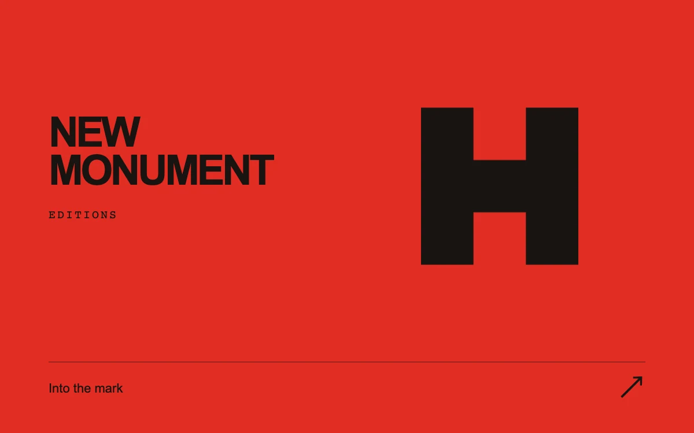

# Mark focus

> An architectural monogram moves from a complete lockup to a precisely framed close-up.

- **Common name:** Logo zoom transition
- **Category:** Animation & motion
- **Live demo:** https://www.subframe.com/motion/mark-focus
- **Source:** Subframe (original, MIT)
- **Dependencies:** none

## Use case

Direct attention from an identity system to its defining shape.

## Interaction

Enter or leave the mark.

## Look

Flat vermilion page with a heavy black stacked sans wordmark at left, a large black geometric monogram at right and a ruled text button.

## Motion

Clicking eases the monogram to centre with exponential smoothing while it scales to 3.9× and turns 45°; the wordmark fades and slides left, and clicking again reverses mid-flight.

## How to adapt

`tick` eases `value` toward `target` at rate 7, and `draw` maps it to the mark's position, scale (2.9) and 45° rotation plus the wordmark fade. Replace the `mf-mark` SVG path and `mf-wordmark` text with your own identity.

## Reduced motion

The framing change resolves immediately for keyboard and reduced-motion users.

## Limitations

Independent fictional identity artwork. A bounded 2D transform study, not a camera or arbitrary element focus manager.

## Taxonomy

- **Components:** image, text
- **Triggers:** press, state
- **Techniques:** scale, rotate, fade, slide
- **Feel:** bold, refined
- **Contexts:** landing, editorial
- **Tags:** logo, reframe, zoom, interruptible, transform, identity
- **Also known as:** zoom into logo, brand mark reveal, monogram close-up, logo reframe animation
- **Surface color:** `#e02d23`

## Code

See [`component.tsx`](component.tsx).
