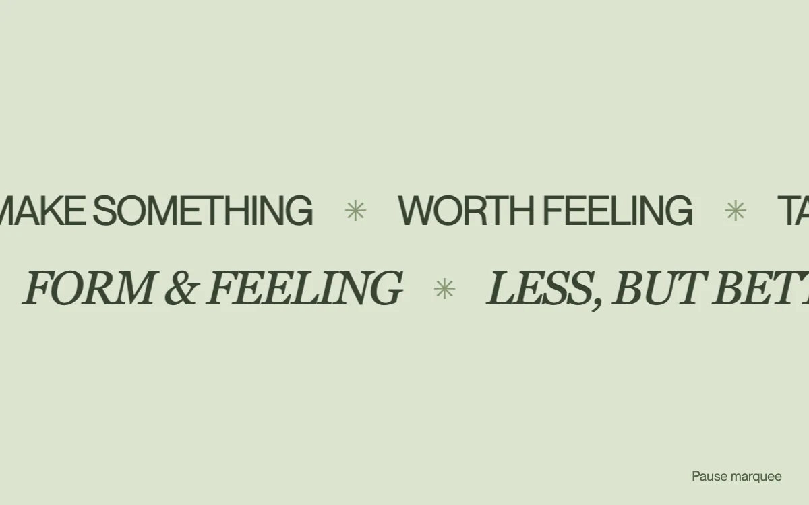

# Passing words

> Two strips of expressive type move in opposite directions.

- **Common name:** Infinite text marquee
- **Category:** Animation & motion
- **Live demo:** https://www.subframe.com/motion/marquee
- **Source:** Magic UI (adapted, MIT) — https://magicui.design/docs/components/marquee · [original code](https://github.com/magicuidesign/magicui/blob/85f97fd27b053339af74ba9dd4ca428ee25989fb/apps/www/registry/magicui/marquee.tsx)
- **Dependencies:** none

## Use case

Introduce a short set of themes on an editorial or campaign page.

## Interaction

Pause the movement or hover the strips

## Look

Pale sage-green field with two full-width rows of dark olive uppercase type, tight sans-serif above italic serif, words divided by pale asterisks.

## Motion

Two rows of repeated word groups scroll horizontally at constant linear speed in opposite directions, looping every 30 s; hovering with a fine pointer or the pause button stops them.

## How to adapt

Travel is the `mg-marquee-travel` keyframe (`translateX(calc(-100% - 24px))`, 30 s linear) on three `mg-marquee-group` copies per row, reversed by `mg-marquee-reverse`; keep the 24px gap in sync with the keyframe. Replace the `rows` word arrays.

## Reduced motion

Both rows become static wrapping text; decorative duplicates are removed.

## Limitations

Use for supplemental copy. Continuous movement needs its pause control; repeated groups are hidden from assistive technology.

## Taxonomy

- **Components:** text
- **Triggers:** ambient, hover
- **Techniques:** loop, slide
- **Feel:** calm, refined
- **Contexts:** landing, editorial
- **Tags:** marquee, text, typography, continuous, opposing directions, loop, hover pause
- **Also known as:** scrolling text ticker, infinite scrolling banner, ticker tape, looping headline strip
- **Surface color:** `#dce4cf`

## Code

See [`component.tsx`](component.tsx).
