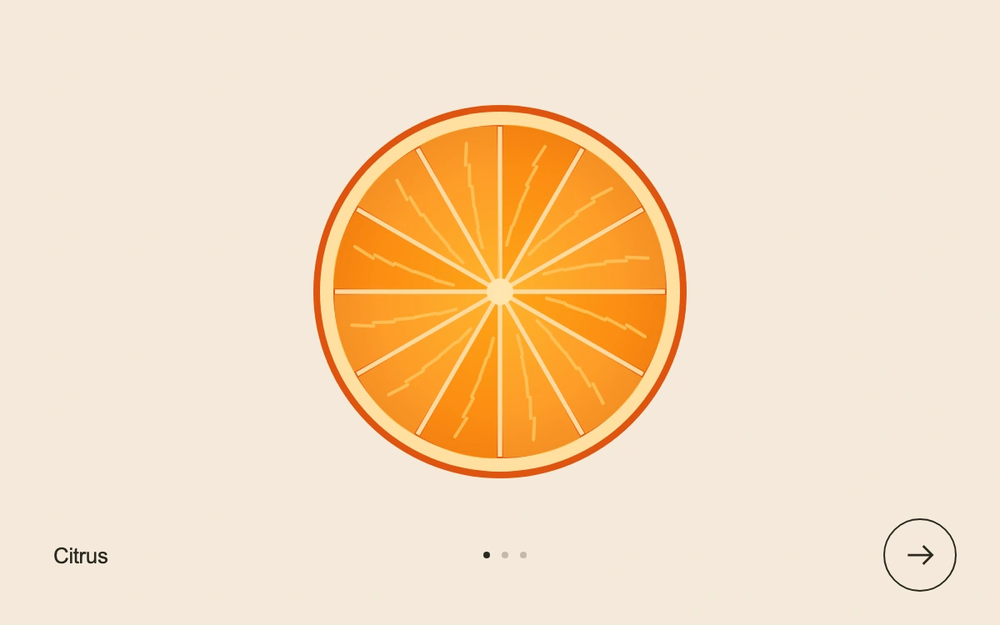

# Same circle, new world

> Citrus, vinyl and a wheel share one circular anchor and uninterrupted angular motion through a timed match cut.

- **Common name:** Match cut scene transition
- **Category:** Animation & motion
- **Live demo:** https://www.subframe.com/motion/match-cut
- **Source:** Subframe (original, MIT)
- **Dependencies:** none

## Use case

Connect distinct subjects in a concise brand or product sequence.

## Interaction

Cut to the next scene

## Look

Flat illustrated orange slice centred on a warm cream background, with a small sans label, three dots and a circular outlined arrow button below.

## Motion

Pressing next spins the disc 360° over 680 ms (cubic ease-in-out) with blur peaking mid-turn, where the artwork and background cut to the next subject at top speed.

## How to adapt

`next` runs a `requestAnimationFrame` `tick` (680 ms) that writes `rotate` and `blur` straight to `disc` and swaps `scene` at `t >= 0.5`. Replace `SCENES`, the three SVG subjects (keep a shared centre and outline) and the `data-scene` backgrounds.

## Reduced motion

Reduced motion and keyboard activation change scene immediately. Keyboard activation also settles an interrupted pointer transition.

## Limitations

Three original SVG subjects and a finite scene transition; no video rendering, timeline editor or audio.

## Taxonomy

- **Components:** scene, navigation
- **Triggers:** press
- **Techniques:** rotate, blur
- **Feel:** bold, playful
- **Contexts:** landing, editorial
- **Tags:** match cut, continuity, scene, film, composition, angular velocity, circle
- **Also known as:** graphic match transition, spin transition, shape continuity cut, cinematic scene change
- **Surface color:** `#f4eada`

## Code

See [`component.tsx`](component.tsx).
