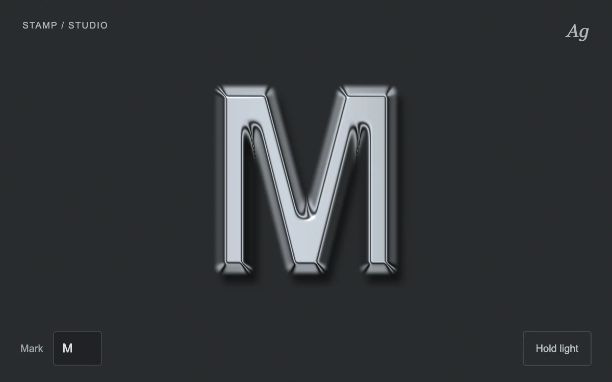

# Metal emblem

> An editable letter becomes a machined silver relief with directional highlights and a graphite surround.

- **Common name:** Embossed metal text shader
- **Category:** WebGL & shaders
- **Live demo:** https://www.subframe.com/motion/metal-emblem
- **Source:** Subframe (original, MIT)
- **Dependencies:** none

## Use case

Experiment with material light on a typographic mark without importing a 3D mesh.

## Interaction

Change the mark, move the light or hold it in place.

## Look

Heavy bevelled silver letter with polished highlights and a soft shadow on dark graphite, with small grey header text and outlined input and button.

## Motion

The light sways slowly on a sine while reflective bands drift across the relief; the pointer re-aims the light, a button freezes the loop, and typing re-renders the letter.

## How to adapt

Lighting is the `metal` shader: `light` plus a `sin(time*.33)*.25` sway, with specular exponent and band frequency both `22.`; `update` rasterises `text` into a blurred 16-bit height map (`radius = 9`). Replace the mark and header; keep the `me-fallback` layer.

## Reduced motion

The automatic light is held still; mark editing and direct lighting control remain.

## Limitations

A procedural glyph height mask produces a 2.5D surface, not extruded geometry. Native WebGL 1 falls back to the editable flat mark.

## Taxonomy

- **Components:** text
- **Triggers:** pointer, ambient
- **Techniques:** shader, glow, 3d
- **Feel:** refined, bold
- **Contexts:** landing
- **Tags:** metal, typography, relief, lighting, shader, WebGL
- **Also known as:** chrome text effect, metallic logo shader, 3D bevelled monogram, silver relief lettering
- **Surface color:** `#191b1d`

## Code

See [`component.tsx`](component.tsx).
