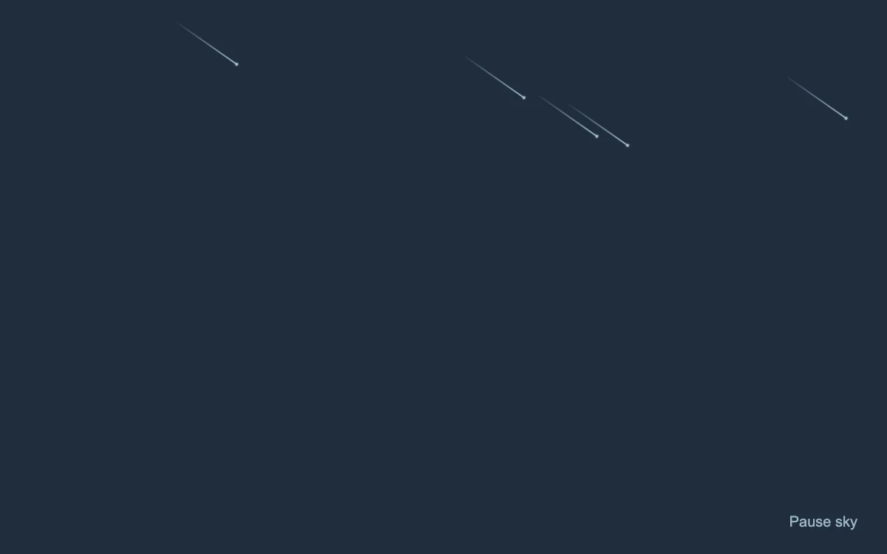

# Passing light

> Thin streaks of light cross a quiet sky at different speeds.

- **Common name:** Meteor shower background
- **Category:** Animation & motion
- **Live demo:** https://www.subframe.com/motion/meteors
- **Source:** Magic UI (adapted, MIT) — https://magicui.design/docs/components/meteors · [original code](https://github.com/magicuidesign/magicui/blob/85f97fd27b053339af74ba9dd4ca428ee25989fb/apps/www/registry/magicui/meteors.tsx)
- **Dependencies:** none

## Use case

Create a small atmospheric illustration or a contemplative cover.

## Interaction

Play or pause the passing lights

## Look

Flat dark slate-blue field crossed by a few thin pale-blue diagonal streaks, each a dot head trailing a fading tail.

## Motion

Nine streaks fall from the top edge toward the lower right, each crossing 500 px linearly in 4–7 s on staggered infinite loops, fading over the final 30%.

## How to adapt

Motion is the `mg-meteor-fall` keyframes (`rotate(-145deg)` sets the angle, `translateX(-500px)` the travel); the `meteors` array sets count, `left`, `duration` and `delay` per streak. Restyle `.mg-meteors-meteor` and its `::after` tail; keep the pause button and reduced-motion rule.

## Reduced motion

The streaks become small stationary stars.

## Limitations

Decorative only; never conveys real progress or status. Nine deterministic streaks stay inside the example container.

## Taxonomy

- **Components:** background
- **Triggers:** ambient
- **Techniques:** particles, loop, fade
- **Feel:** calm
- **Contexts:** landing, editorial
- **Tags:** meteors, particles, streak, sky, background, loop, ambient
- **Also known as:** shooting stars background, falling stars animation, night sky hero, comet streaks
- **Surface color:** `#202d3c`

## Code

See [`component.tsx`](component.tsx).
