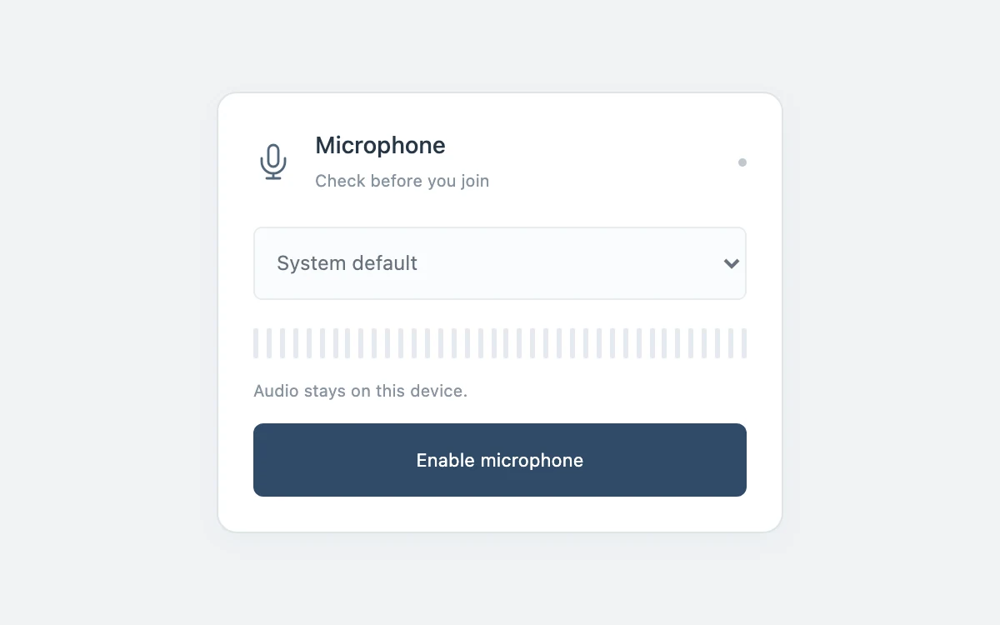

# Microphone check

> A compact audio preflight reveals available input devices and a measured level meter.

- **Common name:** Microphone level meter
- **Category:** Components & interactions
- **Live demo:** https://www.subframe.com/motion/microphone-check
- **Source:** Subframe (original, MIT)
- **Dependencies:** none

## Use case

Select a working input before entering a call.

## Interaction

Enable the microphone, choose a device, then mute or disconnect.

## Look

White rounded card on a pale grey-blue page: microphone icon, device dropdown, a row of thin grey meter bars and a full-width navy button.

## Motion

Once the microphone is enabled, 38 bars light from the left in proportion to the live RMS input level, sampled every 65 ms without tweening; muting zeroes it.

## How to adapt

Sampling is the `setInterval` effect reading `getFloatTimeDomainData` from the `analyser` (gain `* 5`, period `reduced ? 250 : 65`); `.meter` renders 38 `data-on` bars. Device access lives in `connect` and `release`; replace the copy and palette.

## Reduced motion

The real level meter updates at four samples per second without tweening.

## Limitations

Requires an explicit permission grant and an available input device. Audio stays local and is not recorded or sent.

## Taxonomy

- **Components:** media, chart
- **Triggers:** state, press
- **Techniques:** glow
- **Feel:** subtle, technical
- **Contexts:** app
- **Tags:** microphone, permission, audio, device, meter, input
- **Also known as:** audio input level meter, mic test before call, VU meter, microphone permission prompt, audio device selector
- **Surface color:** `#f0f3f5`

## Code

See [`component.tsx`](component.tsx).
