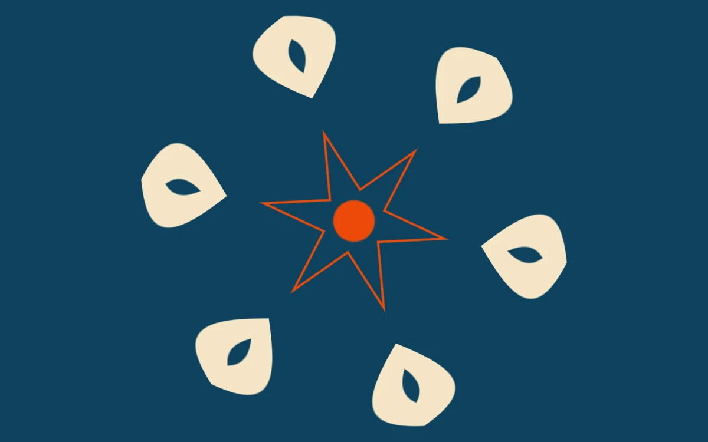

# Mirror chamber

> A folded white motif reflects into a changing peacock-blue radial composition.

- **Common name:** Kaleidoscope shader
- **Category:** WebGL & shaders
- **Live demo:** https://www.subframe.com/motion/mirror-chamber
- **Source:** Subframe (original, MIT)
- **Dependencies:** none

## Use case

Generate symmetry from a single authored motif with an editable reflection count.

## Interaction

Adjust reflections.

## Look

Flat peacock-blue field with six cream petal shapes, each with a leaf-shaped cut-out, ringed around a thin orange star outline and orange dot.

## Motion

Mirrored wedges rotate slowly while the motif turns inside them, producing a continuously shifting kaleidoscope; the Reflections slider steps between 3 and 10 sectors.

## How to adapt

The fold lives in `FRAGMENT`: `sectors` (from `u_control`) sets the wedge count, `u_time*.04` spins the fold and `rot(.5+u_time*.055)` turns the motif. Redraw the motif masks and swap `blue`, `white` and `orange`; keep the fallback and reduced-motion branch.

## Reduced motion

The elapsed-time clock stops. Parameter controls immediately update the static composition.

## Limitations

Requires WebGL 1; a static CSS swatch appears if unavailable or after context loss. Reflects included procedural geometry only; no external image or arbitrary page sampling.

## Taxonomy

- **Components:** background
- **Triggers:** ambient
- **Techniques:** shader, rotate
- **Feel:** calm, playful
- **Contexts:** landing, editorial
- **Tags:** native webgl, kaleidoscope, polar fold, mirror, radial, symmetry
- **Also known as:** kaleidoscope background, radial symmetry pattern, mandala animation, mirrored pattern shader
- **Surface color:** `#153e58`

## Code

See [`component.tsx`](component.tsx).
