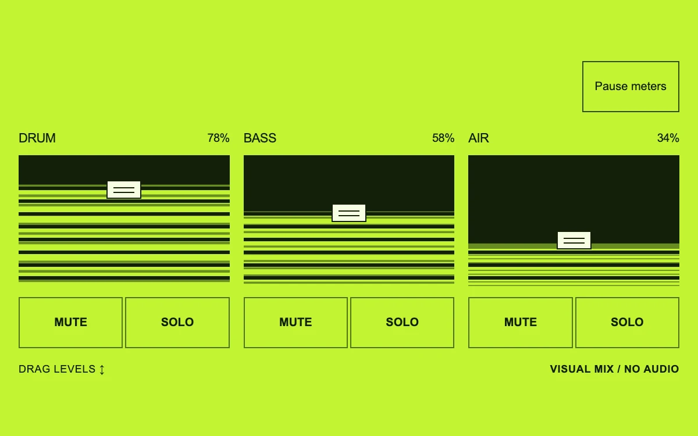

# Make space

> Three oversized digital channels turn level, mute and solo into a graphic rhythm surface.

- **Common name:** Audio mixer faders
- **Category:** Components & interactions
- **Live demo:** https://www.subframe.com/motion/mixing-desk
- **Source:** Subframe (original, MIT)
- **Dependencies:** none

## Use case

Expose the relationship between independent channels and a final composition in an audio tool or a layered visual editor.

## Interaction

Drag levels, mute channels, or isolate a solo

## Look

Acid-lime page with three near-black fader wells striped by lime meter bars, small white rectangular handles, outlined square toggle buttons and plain sans-serif labels.

## Motion

Striped meters pulse within each fader's level on staggered 750–970 ms linear loops; dragging a fader sets its fill and handle position directly, and mute or solo hides meters.

## How to adapt

Meters are `.sf-mix-signal` scaled by the `sf-mix-level` keyframes inside `.sf-mix-fill`, whose `scaleY` follows `levels`; `silent` derives from `muted` and `solo`. Replace `channels` and drive `levels` and meter scale from real gain and analyser values.

## Reduced motion

Meter animation becomes a stable representative level while volume, mute and solo remain usable.

## Limitations

Visual control demo with synthetic meters and no sound. Wire levels to actual gain and meter values to an analyser; percentages are not a calibrated decibel scale.

## Taxonomy

- **Components:** slider, media
- **Triggers:** drag, ambient, press
- **Techniques:** scale, loop
- **Feel:** bold, technical
- **Contexts:** app
- **Tags:** audio, mixer, fader, volume, range, slider, mute, solo, meter, lime, graphic, digital, control
- **Also known as:** volume faders, channel strips, vertical level meters, mute and solo controls
- **Surface color:** `#c2f431`

## Code

See [`component.tsx`](component.tsx).
