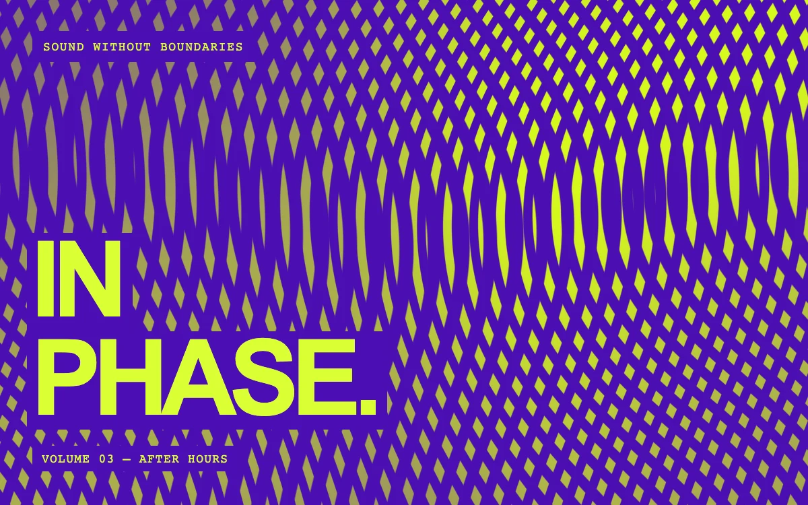

# Moiré weave

> Two drifting line screens fold into an acid and violet optical weave.

- **Common name:** Moiré pattern shader
- **Category:** WebGL & shaders
- **Live demo:** https://www.subframe.com/motion/moire-weave
- **Source:** Subframe (original, MIT)
- **Dependencies:** none

## Use case

Club posters, experimental sound festivals, motion identities, or an assertive editorial section.

## Interaction

Play or pause the material study.

## Look

Acid-lime and violet interference weave of fine diamond threads filling the frame, with a heavy lime sans-serif headline and monospace labels on violet blocks.

## Motion

Two dense sine line screens slowly drift and bend against each other in a continuous loop, so the moiré bands shift, fold and change tilt; a button pauses it.

## How to adapt

The pattern is `FRAGMENT`: `waveA` and `waveB` (frequencies `143.0` and `139.0`) interfere, `fold` bends both and `tilt` varies the second screen's angle over `u_time`. Swap the violet and lime `vec3` colours and replace the poster copy in `.sg-moire-weave-title`; check aliasing at final size.

## Reduced motion

Displays one stable, representative frame. Responds immediately when the system preference changes.

## Limitations

Requires WebGL 1; a static CSS composition remains visible when WebGL is unavailable or lost. Dense patterns are intentionally optical. Keep motion slow and offer pause; inspect for aliasing at the final size.

## Taxonomy

- **Components:** background
- **Triggers:** ambient
- **Techniques:** shader, distortion
- **Feel:** bold
- **Contexts:** landing, editorial
- **Tags:** moire, interference, woven, optical, acid, violet, music, poster, native webgl
- **Also known as:** moiré interference background, op art animation, optical illusion pattern, line interference shader, rave poster background
- **Surface color:** `#5220c5`

## Code

See [`component.tsx`](component.tsx).
