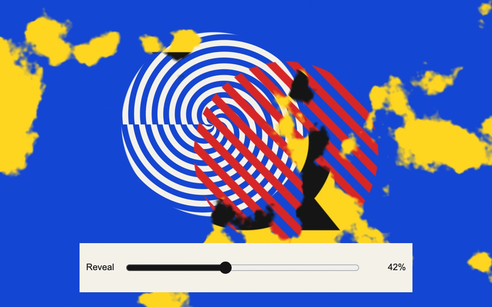

# Noise threshold

> Two bold primary-color prints exchange places through a continuous, seeded erosion field.

- **Common name:** Noise dissolve transition
- **Category:** WebGL & shaders
- **Live demo:** https://www.subframe.com/motion/noise-threshold
- **Source:** Subframe (original, MIT)
- **Dependencies:** none

## Use case

Scrub or reverse an organic reveal at exact progress values without changing the underlying pattern.

## Interaction

Scrub the reveal in either direction.

## Look

Flat primary-colour poster art: cobalt field with cream concentric rings and red stripes, broken by cloudy yellow patches with black shapes, above a cream slider.

## Motion

Scrubbing the slider thresholds a fixed five-octave noise field, eroding the blue composition in cloudy patches into the yellow and black one; reversible, with no autonomous motion.

## How to adapt

The dissolve is `reveal` in `fragment`: a `smoothstep` around the seeded `noise` `threshold`, compared with `mix(-.1,1.1,value)`, edge softness `.028`. `front` and `back` are the two procedural compositions; swap them for texture samples or your own artwork.

## Reduced motion

The composition only updates on direct input; there is no autonomous motion or animated easing.

## Limitations

A fixed five-octave value-noise field masks two original procedural compositions. No images or video are sampled. Requires WebGL 1; static SVG artwork appears during failure or context loss, and the renderer rebuilds on restoration.

## Taxonomy

- **Components:** image, background
- **Triggers:** state, drag
- **Techniques:** shader, noise, mask
- **Feel:** bold
- **Contexts:** landing, editorial
- **Tags:** native webgl, noise, deterministic, threshold, reveal, scrub, reversible, mask
- **Also known as:** dissolve wipe, organic noise reveal, burn-away transition, scrubbable image transition
- **Surface color:** `#1346d3`

## Code

See [`component.tsx`](component.tsx).
