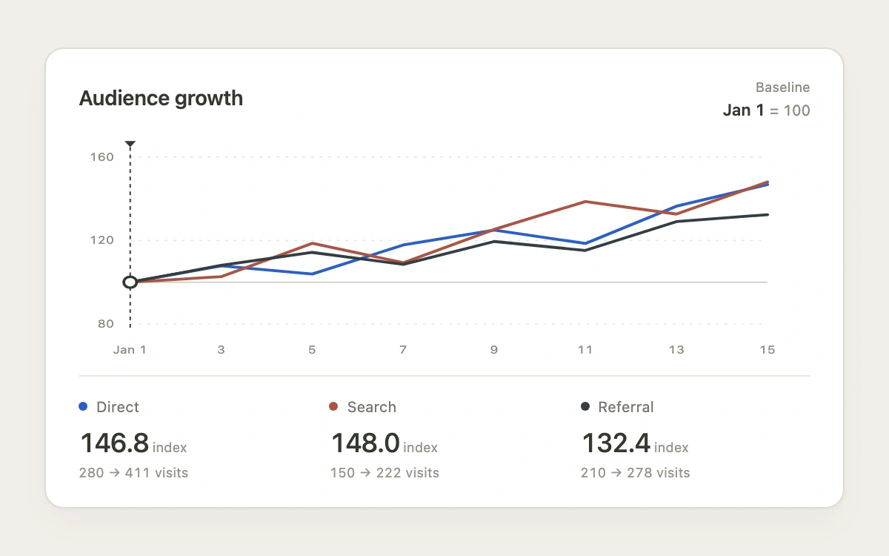

# Choose the comparison day

> Choosing a date rebases each series to 100 so growth can be compared from the same starting point.

- **Common name:** Indexed baseline comparison
- **Category:** Components & interactions
- **Live demo:** https://www.subframe.com/motion/normalized-baseline
- **Source:** Subframe (original, MIT)
- **Dependencies:** none

## Use case

Compare relative change across series with different raw scales.

## Interaction

Select a date in the chart, or use arrow keys, Home and End to move the baseline.

## Look

Warm-white chart card with cobalt, brick and ink lines, a dark baseline peg and compact raw-value summaries.

## Motion

Selecting a date recalculates every path immediately and moves the dashed baseline peg over 160 ms. All available series meet at index 100 at that date.

## How to adapt

`Chart` divides each value in `SERIES` by its selected baseline and derives the vertical range. The `.nb-peg` transform is the only animated chart property. `DEFAULT_CONFIG` and the `config` prop expose fixture size, raw values and peg timing.

## Reduced motion

Series values update immediately. The baseline peg skips its 160 ms transition for keyboard input, reduced motion and inactive hosts.

## Limitations

Four fixed, positive fictional traffic series. No live analytics, financial returns or statistical inference. Configuring series or observation counts resets the selected baseline.

## Taxonomy

- **Components:** chart, number
- **Triggers:** press, keyboard, state
- **Techniques:** slide, path
- **Feel:** refined, technical
- **Contexts:** app, dashboard
- **Tags:** chart, baseline, indexed, normalized, comparison, growth, series, data
- **Also known as:** rebase line chart, indexed growth chart, normalize series to 100, comparison starting point
- **Surface color:** `#f1eee8`

## Code

See [`component.tsx`](component.tsx).
